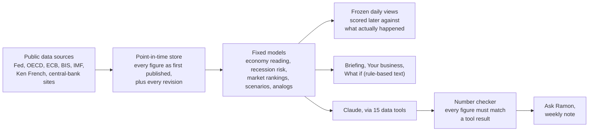

# Ramon

**An economy and markets research assistant that turns public data into plain-language
briefings, and checks every number it tells you.**

Ramon follows the US and global economy, central banks and financial markets. It explains
what is happening and what it could mean for a business: in a one-page daily briefing, in
one-click "what if" scenarios, and in a chat that answers questions in everyday language.
Under the hood, a research engine keeps every figure exactly as it was first published,
runs fixed statistical models on it, and an AI layer (Claude) explains the results without
being allowed to make numbers up.

> Research and decision support only. Ramon does not trade, and nothing it shows is
> investment advice.

| | |
|---|---|
| **For** | Executives who want the "so what" (Briefing, Ask Ramon, What if), and analysts who want the detail behind it (Analyst view) |
| **Runs on** | One computer (macOS today), opened in a web browser at `http://127.0.0.1:8710/` |
| **Data** | Free public sources: St. Louis Fed, Ken French data library, OECD, ECB, BIS, IMF (including world commodity prices), Federal Reserve and ECB websites |
| **AI** | Claude by Anthropic, for chat answers, the weekly note and reading central-bank statements |
| **Status** | Working research system. Key limitation: apart from early promise for commodities, the market rankings have **not** shown reliable skill on 2021-2025 data (see [Track record](#6-track-record)) |

## Contents

1. [What you get](#1-what-you-get)
2. [How it works](#2-how-it-works)
3. [Where the data comes from](#3-where-the-data-comes-from)
4. [What the models do](#4-what-the-models-do)
5. [Why you can trust the numbers](#5-why-you-can-trust-the-numbers)
6. [Track record](#6-track-record)
7. [Limitations (read this)](#7-limitations-read-this)
8. [Getting started](#8-getting-started)
9. [Day-to-day operation](#9-day-to-day-operation)
10. [Configuration](#10-configuration)
11. [Running costs](#11-running-costs)
12. [Reference: commands, API, project layout](#12-reference)
13. [Quality and testing](#13-quality-and-testing)
14. [Project status and roadmap](#14-project-status-and-roadmap)
15. [Further documentation](#15-further-documentation)

---

## 1. What you get

### The web app

Start it with `ramon api serve` and open **http://127.0.0.1:8710/**.

| Page | What it shows | Uses AI? |
|---|---|---|
| **Briefing** (home) | The economy in one sentence; overall picture, recession risk, current growth and borrowing conditions with traffic lights; what changed in the past month; prices that matter (oil, gas, metals, wheat, gold, the dollar, Treasury and mortgage rates) over 3 and 12 months with big moves flagged; what the Fed and ECB decided and their tone; where the models lean; recent warnings. Print or save it as a PDF. | No. Fixed rules turn numbers into sentences. |
| **Your watchlist** (on the Briefing) | The items you pin from Your business, each with a one-line summary (for example "Wheat: up 59% in a year; slight lean in its favor (53%); most exposed when the dollar strengthened 10%"). Kept in your browser. | No |
| **Your business** (on the Briefing) | Pick a US sector, a stock market abroad, a major or emerging-market currency you are exposed to, or a commodity you buy or sell (energy, metals, crops). See the model lean and what drives it, how it moved in each what-if event, and what followed in the past periods most like today. | No |
| **What if…?** | One-click events (oil up or down 30%, interest rates up or down 1 point, market panic, a stronger dollar, rising inflation fears) with a winners-and-losers chart for sectors, world stock markets, major or emerging-market currencies, government bonds or commodities. | No |
| **Ask Ramon** | Chat. Ask in your own words; answers come in plain language, with the data steps shown and a "✓ Every number checked" line. | Yes (Claude) |
| **How it works** | A plain-language explanation of the data, models and checks, plus a glossary. | No |
| **Analyst view** (checkbox) | Adds the technical pages: macro detail, model views with ranges, a custom scenario builder, historical analogs, and system status with the track record. Chat answers switch to analyst style. | Partly |

### Reports and alerts

- **Executive briefing note**: `ramon report briefing` writes the Briefing as a short
  document to `data/reports/<date>/briefing.md`. It is written every Monday automatically, including a watchlist section for the items listed in
  `config/watchlist.yaml`.
- **Weekly research note**: a longer analyst note drafted by Claude, reviewed by a second
  "red team" pass, with every number checked (`ramon report weekly`, Mondays 07:00).
- **Alerts**: rules in `config/alerts.yaml`, for example the recession probability crossing
  40%, a jump in corporate borrowing spreads, a central-bank rate change, a key commodity
  rising or falling 20% in three months, or a model lean flipping. They are logged daily and can be sent to ntfy or Slack once configured.

### Other interfaces

- **Command line**: `ramon ask "Is a recession coming?"` and about 20 command groups
  ([reference](#commands)).
- **HTTP API**: read-only JSON endpoints for everything the app shows, documented at
  `http://127.0.0.1:8710/docs`.

---

## 2. How it works



1. **Collect.** Every weekday morning a scheduled job pulls new data from each source. A
   second job picks up scheduled US releases (jobs, inflation, retail sales and others)
   shortly after they come out.
2. **Store as it was known.** Each figure is saved with the date it became public, and
   revisions are added rather than overwriting it. Ramon can therefore answer "what did we
   know on 30 September 2008?" without being helped by later corrections. This prevents
   the most common way research flatters itself.
3. **Model.** Fixed, tested models turn the data into readings: the state of the economy,
   recession risk, rankings of sectors, countries, currencies and bonds, and how markets
   reacted to past events.
4. **Freeze and score.** Each month's views are frozen and written once. When their
   horizon has passed, they are scored against what actually happened. This is the live
   track record, and it cannot be edited after the fact.
5. **Explain.** The Briefing and What if pages turn the numbers into sentences with fixed
   rules. The chat uses Claude, which can only see the engine's results through 15 data
   tools, and an automatic checker compares every number in its answer with those results.

---

## 3. Where the data comes from

All sources are free and public. Only FRED needs a (free) key.

| Source | What Ramon uses | Key needed |
|---|---|---|
| **St. Louis Fed (FRED / ALFRED)** | US growth, jobs, inflation, interest rates, credit spreads, market volatility, with full revision history; Atlanta Fed GDPNow | Free FRED key |
| **Kenneth French data library** (Dartmouth) | Returns for 12 and 49 US industries and standard market factors, back to 1926 | No |
| **OECD** | Leading indicators, share prices and 10-year yields for 14 countries; short-term interest rates for developed and emerging markets | No |
| **ECB** | Euro exchange rates (including 14 emerging-market currencies) and yield curve; monetary-policy statements and press-conference transcripts | No |
| **BIS, IMF** | Real effective exchange rates, consumer prices | No |
| **IMF commodity prices (PCPS)** | Monthly world benchmark prices for 17 commodities since 1992: oil, gas, coal, copper, aluminum, nickel, zinc, iron ore, gold, silver, wheat, corn, soybeans, sugar, coffee, cotton | No |
| **Federal Reserve website** | FOMC statements and minutes | No |

The catalog of 344 series is in `config/series.yaml`. Raw downloads are archived under
`data/raw/` so any figure can be traced back to its source.

**Not included yet:** individual company prices and fundamentals (needs a paid vendor, see
[roadmap](#14-project-status-and-roadmap)), earnings-call transcripts and news.

---

## 4. What the models do

| Reading | Method, in plain terms |
|---|---|
| **Economy (growth, inflation, financial conditions)** | Dozens of indicators combined into three scores relative to trend, and the probability of each of four "economic weather" types (healthy growth; strong growth with rising inflation; soft growth with elevated inflation; slowing growth with easing inflation). A second statistical model gives an independent opinion. |
| **Recession risk (12 months)** | A statistical model trained on past US recessions as dated by the NBER, using only data available at each point in time. |
| **Current growth** | The Atlanta Fed's GDPNow estimate. Ramon's own free-data nowcast did not beat it, so GDPNow is shown instead. |
| **Market leans** | For US industries, country stock markets, major and emerging-market currencies, government bonds and commodities: a combination of well-studied signals (price trends, valuation, steadiness, interest-rate advantage, leading indicators), giving each asset's chance of beating its peers over 1 and 3 months, with a likely range. |
| **What if…?** | How each asset moved in the same month as past moves in oil, interest rates, the dollar, market fear and inflation expectations, estimated on about 20 years of monthly history. |
| **Similar periods** | The past months whose economic readings most resemble today's, and how each asset did over the following year. |
| **Central-bank tone** | Claude reads each new Fed and ECB statement once and records the decision and tone (from strongly dovish to strongly hawkish). The rate decision is also extracted by fixed rules as a cross-check. |

Every signal has a "card" with its research results in `docs/signals/`. The full
specification is in [PRD.md](PRD.md).

---

## 5. Why you can trust the numbers

| Safeguard | What it guarantees |
|---|---|
| **Point-in-time data** | Models and backtests see only what was public at the time, including the unrevised first release. A dedicated test suite tries to leak future data and must fail to do so before any change can be merged. |
| **Rule-based briefing** | The Briefing, Your business and What if pages contain no AI-written text: the same data always gives the same words. |
| **Number checker** | Every number in a chat answer or weekly note is compared with the engine's results. Claude gets one chance to fix any mismatch; if one remains, the answer is flagged with ⚠. |
| **Locked holdout** | 2021-2025 was set aside as test data the models were never tuned on. It can be opened only once per model family, and every opening is logged. |
| **Frozen views** | Each month's views are written once and later scored against reality; they cannot be edited. |
| **Reproducibility** | `ramon reproduce <view_id>` rebuilds any published view from its pinned data snapshot and confirms it matches. |
| **Strict promotion gates** | A signal is promoted only if it passes six statistical tests, including corrections for having tried many ideas. |
| **Answer testing** | A set of 176 test questions is scored on number accuracy, use of the right data, and an independent AI grader's view of correctness, honesty about uncertainty and clarity. Executive-style answers also lose points for jargon. |
| **No advice** | The assistant declines personalized investment advice and says when something is not available rather than guessing. |

---

## 6. Track record

The honest summary is that **the economic readings describe published data well, but the
market rankings have not yet shown reliable predictive skill on data they never saw**, with
commodities and emerging-market currencies the early exceptions (see the caveats in the table).

| Test | Result |
|---|---|
| Recession model (point-in-time backtest) | Separates the run-up to recessions from other periods well (AUC 0.90, where 0.5 is a coin flip and 1.0 is perfect) |
| Market rankings, 2021-2025 holdout (3-month) | Sectors, countries, currencies and bonds: correlation with actual outcomes between -0.065 and +0.044, none statistically significant (no better than a simple average). Commodities: +0.091, right in 60% of months, t-statistic 1.73: promising but short of the usual significance bar. Emerging-market currencies: +0.299, right in 72% of months, t-statistic 4.57; mostly the interest the higher-yielding currencies pay (known in advance), plus a period that suited them: on the exchange rate alone the same ranking showed no edge before 2021. |
| Signal promotion gates | 0 of 84 signal-market pairs pass all six gates; 14 pass five of six |
| Assistant answers | 97.3 / 100 on the analyst question set; 96.2 / 100 on the executive questions, with every number traced to the data |

That is why the app labels the market leans as "context for discussion, not calls". The
live paper track (views frozen each month and scored later) keeps building evidence
automatically. See `docs/phase3_status.md` for the full research status.

---

## 7. Limitations (read this)

- **The market leans are weak evidence.** See the [track record](#6-track-record). Use the
  economy and central-bank readings as descriptions of the present, and the leans only as
  a prompt for discussion.
- **"What if" is history, not a forecast.** It shows how assets usually moved together in
  the same month. Real events rarely repeat history exactly.
- **Coverage.** US industries, 14 country stock markets, 8 major and 9 emerging-market
  currencies, 9 government bond markets and 17 commodities. No individual companies or credit
  products yet.
- **Currency rankings include the interest earned** on holding a currency. A business that
  only converts money does not earn it; the app says how much of a currency lean is interest.
- **Commodity prices are monthly averages** of world benchmark spot prices in US dollars,
  not futures returns or the price any one buyer pays.
- **Monthly data.** Most economic data is monthly and published with a delay. The Briefing
  says which month it reflects.
- **Single machine.** Ramon runs on one computer and serves the web app on that computer
  only, unless an access token is set.
- **AI dependency.** Ask Ramon and the weekly note need an Anthropic API key and use paid
  tokens. Everything else works without them.
- **Not investment advice.** Ramon is a research tool and does not place trades.

---

## 8. Getting started

### Requirements

- macOS or Linux with Python 3.12 or newer
- [`uv`](https://docs.astral.sh/uv/) (Python package manager)
- A free [FRED API key](https://fredaccount.stlouisfed.org/apikeys)
- Optional, for chat and the weekly note: an [Anthropic API key](https://platform.claude.com/settings/keys)

### Install

```bash
git clone https://github.com/pabloapcv/quant-ai-.git ramon && cd ramon
uv sync --all-groups
cp .env.example .env
```

Edit `.env` and fill in `ATLAS_FRED_API_KEY` (and `ANTHROPIC_API_KEY` for the chat). The
`.env` file is never committed.

### Load the data (first time)

```bash
uv run ramon ingest fred --all      # US economic data with full revision history
uv run ramon ingest kenfrench --all # US industry returns and factors
uv run ramon ingest sdmx            # OECD, ECB, BIS, IMF
uv run ramon pipeline daily         # everything else: text, views, snapshot, alerts
```

The first full load takes a while; later daily runs only fetch what is new.

### Open the app

```bash
uv run ramon api serve
```

Then open **http://127.0.0.1:8710/**. The server prepares the Briefing and the Your
business data in the background and keeps them on disk for the day, so only the first start
after a new pipeline run takes a few minutes; restarts after that are instant.

---

## 9. Day-to-day operation

Ramon runs itself through scheduled jobs (macOS launchd). After installation, nobody needs
to start anything except the web app.

| Job | When | What it does | Output |
|---|---|---|---|
| Daily pipeline | Weekdays 06:30 | Ingest all sources, quality checks, snapshot, freeze views, score the live track, run alerts | `data/runs/` |
| Release-day ingest | Weekdays 06:45 | Picks up the day's scheduled US releases shortly after publication | `data/runs/releases-<date>.json` |
| Weekly notes | Mondays 07:00 | Executive briefing note, then the Claude-written research note | `data/reports/<date>/` |
| Web app (optional) | Always | Keeps the app running at login and restarts it if it stops | `data/runs/web-launchd.log` |

The job definitions and install commands are in `deploy/launchd/` and
[docs/runbooks.md](docs/runbooks.md), which also covers reading a run report, alerts,
recovery and monitoring. If the Mac is asleep at a scheduled time, the job runs when it
wakes.

---

## 10. Configuration

Settings come from environment variables or `.env`. The `ATLAS_` prefix is kept from the
project's earlier name so existing jobs keep working.

| Variable | Purpose | Default |
|---|---|---|
| `ATLAS_FRED_API_KEY` | FRED access (required) | none |
| `ANTHROPIC_API_KEY` | Claude access for chat, weekly note and statement reading | none (or `ant auth login`) |
| `ATLAS_LLM_DAILY_TOKEN_BUDGET` | Hard daily cap on Claude usage, in weighted tokens (0 = no cap) | 3,000,000 |
| `ATLAS_ASSISTANT_MODEL` | Claude model for the assistant | `claude-opus-5-5` |
| `ATLAS_API_TOKEN` | Required to serve the app beyond this computer | none (localhost only) |
| `ATLAS_NTFY_TOPIC_URL` | Push alerts and the weekly digest to your phone (ntfy) | none |
| `ATLAS_SLACK_WEBHOOK_URL` | Post alerts and the weekly digest to Slack | none |
| `ATLAS_DATA_DIR` | Where data, reports and logs live | `data` |
| `ATLAS_LOG_LEVEL` | Logging detail | `INFO` |

Other configuration files:

- `config/series.yaml`: the data series catalog
- `config/alerts.yaml`: alert rules, thresholds and delivery (ntfy or Slack)
- `config/watchlist.yaml`: the watchlist for the weekly briefing note
- `config/evals/golden.yaml`: the assistant's test questions

---

## 11. Running costs

- **Data:** free. All current sources are public.
- **Claude:** pay-as-you-go through Anthropic. Usage is metered on every call
  (`ramon usage`) and stops at the daily budget. The Briefing, Your business and What if
  pages use no tokens. A chat question typically uses tens of thousands of weighted
  tokens; prompt caching reduces repeat costs.
- **Computer:** runs on an ordinary Mac. The data store is about 100 MB.

---

## 12. Reference

### Commands

`ramon` and `atlas` are the same program. Run `ramon <group> --help` for details.

| Group | Examples |
|---|---|
| Everyday | `ramon api serve`, `ramon ask "..."`, `ramon report briefing`, `ramon report weekly` |
| Economy | `ramon regime now`, `ramon regime now --at 2008-09-30`, `ramon regime analogs --universe ind12` |
| Markets | `ramon views build --universe ctry_dev_lcl`, `ramon portfolio ...`, `ramon scenario run --shock oil=0.3 --universe ind12` |
| Central banks | `ramon text ...` (FOMC and ECB statements, minutes, search) |
| Data | `ramon ingest fred --all`, `ramon ingest kenfrench --all`, `ramon ingest sdmx`, `ramon catalog list`, `ramon pit as-of US.CPI.CORE --at 2020-04-30` |
| Operations | `ramon pipeline daily`, `ramon pipeline track`, `ramon alerts check`, `ramon snapshot create`, `ramon reproduce <view_id>`, `ramon usage`, `ramon metrics` |
| Research | `ramon research signal mom_12_1 --universe ind49`, `ramon research gates --exclude-holdout`, `ramon research cards`, `ramon nowcast ...` |
| Quality | `ramon eval run --category executive` |

### API

All endpoints are read-only except chat. Interactive documentation is at `/docs`.

| Endpoint | Returns |
|---|---|
| `GET /v1/briefing` | The plain-language Briefing |
| `GET /v1/lens?market=&asset=` | Your business view for a sector (`ind12`), stock market (`ctry_usd`), major currency (`fx_g10`), emerging-market currency (`fx_em`) or commodity (`cmdty`) |
| `GET /v1/presets` | The one-click what-if events |
| `POST /v1/scenario` | A what-if run for any combination of shocks |
| `POST /v1/chat` | Ask Ramon (streamed: data steps, then the checked answer) |
| `GET /v1/regime`, `/v1/central-banks` | Economy reading; latest Fed and ECB decisions |
| `GET /v1/views`, `/v1/views/frozen`, `/v1/views/{id}` | Model views, live and frozen |
| `GET /v1/track-record`, `/v1/gates`, `/v1/portfolio`, `/v1/analogs` | Research detail |
| `GET /v1/series/{id}`, `/v1/catalog`, `/v1/universes` | Data access |
| `GET /v1/alerts`, `/v1/usage`, `/v1/snapshots/{id}`, `/health`, `/metrics` | Operations |

### Project layout

```
atlas/                Python package (the engine)
  connectors/         data sources: FRED/ALFRED, Ken French, SDMX (OECD, ECB, BIS, IMF)
  pit/                point-in-time store and snapshots
  quality/            data contracts, staleness and drift checks
  features/           economic indicators as known at each date
  models/             economy reading, recession risk, nowcast, return models, scenarios, risk
  signals/            market signals per universe (industries, countries, FX, bonds, commodities)
  backtest/           backtesting, statistical gates, the locked holdout
  views/              publishing, freezing, scoring and reproducing views
  text/               Fed and ECB documents, search, tone readings
  agent/              Claude assistant, its 15 tools, number checker, evals, weekly note
  briefing.py         rule-based Briefing
  lens.py             Your business views and the what-if events
  api.py, web/        HTTP API and the web app
  pipeline.py         the daily run
  alerts.py, releases.py, metrics.py, cli.py
config/               series catalog, alert rules, test questions
deploy/launchd/       scheduled-job templates
docs/                 runbooks, research status, signal cards
tests/                315 automated tests, including the look-ahead leakage suite
data/                 data, reports and logs (created locally, never committed)
PRD.md                full product and technical specification
```

---

## 13. Quality and testing

- **Automated tests:** 315 tests run on every change in CI (Python 3.12 and 3.13), along with
  linting, formatting and type checks. The look-ahead leakage suite is part of the run and
  blocks merges.
- **Assistant evaluation:** `ramon eval run` asks the 176 test questions and compares the
  score with a saved baseline; a drop of more than 3 points counts as a regression.
- **Run the checks locally:**

```bash
uv run ruff check . && uv run ruff format --check . && uv run mypy && uv run pytest
```

---

## 14. Project status and roadmap

The project is built in phases defined in [PRD.md](PRD.md#15-delivery-plan--acceptance-criteria).

| Phase | Scope | Status |
|---|---|---|
| P0 Foundations | Point-in-time store, connectors, data contracts, snapshots | Done |
| P1 Market data | Company prices and fundamentals, sector history | **Waiting on a paid data vendor** |
| P2 Economy engine | Growth/inflation reading, regimes, recession risk, nowcast | Done (GDPNow used for current growth) |
| P3 Signals and backtester | 34 signals across 10 universes, statistical gates, 118 signal cards, test your own signal file | Built; 0 signals pass every gate |
| P4 Views and portfolio | Ensemble views with ranges, regime context, analogs and risks; model portfolio; Black-Litterman option | Built; 2021-2025 skill below the PRD targets |
| P5 Global | 33 country markets, major and EM currencies, developed and EM bonds, commodities, credit, crypto | Built; global sectors need paid data |
| P6 AI assistant | Tools, chat, number checker, weekly note and digest, evals, central-bank text | Built; sending needs a channel; news needs a source |
| P7 Product | Web app, executive briefing, watchlist, alerts within minutes of releases, monitoring | Done |
| P8 Live paper track | Frozen views scored daily, monthly model review | Running; 12-month track completes about October 2027 |

Criterion-by-criterion status with evidence: [docs/phase_status.md](docs/phase_status.md).

**Next steps:** choose a market-data vendor (P1) and a news source (P6); connect a
delivery channel for alerts and the weekly digest; let the live track accumulate a year of evidence before relying on the market
leans; optional hosted deployment with sign-in.

---

## 15. Further documentation

- [PRD.md](PRD.md): full product and technical specification
- [docs/runbooks.md](docs/runbooks.md): operating guide (jobs, alerts, recovery, API)
- [docs/phase_status.md](docs/phase_status.md): every PRD exit criterion, P3 to P8, with evidence
- [docs/phase3_status.md](docs/phase3_status.md): signal research results
- `docs/signals/`: one research card per signal
- The **How it works** page in the app: the plain-language version of this document

> **Name:** Ramon was previously called Atlas. The Python package is still `atlas` and
> settings keep the `ATLAS_` prefix, so existing jobs and `.env` files keep working.

---

*Ramon is a research tool. It does not provide investment advice, and past patterns do not
guarantee future results.*
