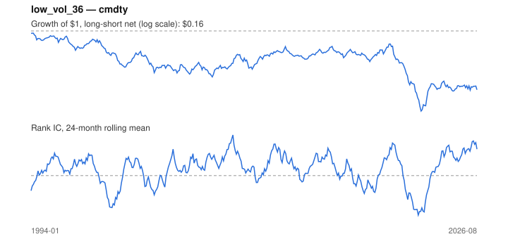

# Signal card: `low_vol_36`

Negative trailing 36-month volatility. Universe: `cmdty`, 1994-01 to 2026-08 (392 months), net of 10 bp per unit of turnover.

Verdict: **Not promoted** — passes 3 of 6 gates; fails ic_tstat, dsr, pbo.

## Why it should work

Leverage-constrained investors bid up high-beta, high-volatility assets, leaving low-volatility assets with higher risk-adjusted returns.

Reference: Ang, Hodrick, Xing & Zhang (2006); Frazzini & Pedersen (2014)

## Data and timing

- Uses returns through the end of month t; the forecast is month t+1's return.
- Source: Ken French data library (industry portfolios, factors), latest vintage.
- Parameters: `{'window': 36}`

## Results

| Metric | Value |
|---|---|
| Mean rank IC | 0.028 |
| IC t-stat (Newey-West) | 1.69 |
| IC information ratio (annual) | 0.35 |
| IC hit rate | 53% |
| Long-short return, annual, net | -3.2% |
| Long-short volatility, annual | 21.8% |
| Sharpe, gross / net | -0.14 / -0.15 |
| Sharpe since 2000, net | -0.07 |
| Probabilistic Sharpe (vs 0) | 0.20 |
| Deflated Sharpe (9 trials) | 0.00 |
| Turnover per month | 0.21 |
| Break-even cost | -121 bp |
| Quintile monotonicity | -0.10 |

IC decay (signal at t vs return k months later): 1m +0.028, 2m +0.028, 3m +0.027, 6m +0.025, 12m +0.016

Annual return by quantile: Q1 +11.2%, Q2 +0.0%, Q3 +8.0%, Q4 +9.8%, Q5 +8.2%

## Promotion gates (PRD §8.4)

| Gate | Threshold | Value | Result |
|---|---|---|---|
| IC t-stat | ≥ 2 | 1.69 | fail |
| Deflated Sharpe | ≥ 0.95 | 0.00 | fail |
| Family PBO | < 20% | 29% | fail |
| Regimes with IC > 0 | ≥ 3 of 4 | 4 of 4 | pass |
| Ensemble ICIR contribution | > 0 | +0.028 | pass |
| Economic rationale | reference | yes | pass |

IC by market regime: down_calm +0.007, down_volatile +0.048, up_calm +0.030, up_volatile +0.015

## Every configuration tried (`low_volatility` family)

PBO across 3 configurations: 29% over 376 common months.

| Configuration | IC | t-stat | Sharpe net | DSR |
|---|---|---|---|---|
| `low_vol_24` | 0.029 | 1.76 | -0.01 | 0.00 |
| `low_vol_60` | 0.017 | 1.02 | -0.12 | 0.00 |
| `low_vol_36` | 0.028 | 1.69 | -0.15 | 0.00 |

## Tearsheet



## Where it breaks

- Worst drawdown: -92%, from Mar 1994 to Jul 2022.
- Worst 12 months: -67%, ending Jul 2022.
- Since 2000 the net Sharpe is -0.07 versus -0.15 over the full sample.

## Reproduce

```bash
uv run atlas ingest kenfrench --all
uv run atlas research gates --universe cmdty --exclude-holdout
uv run atlas research signal low_vol_36 --universe cmdty
```

_Generated by `atlas research cards` on 2026-10-26. Do not edit by hand._
