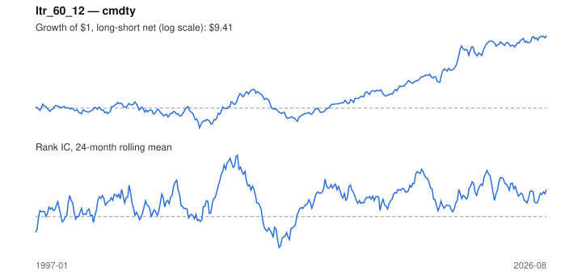

# Signal card: `ltr_60_12`

Negative 60-month return skipping the last 12 months. Universe: `cmdty`, 1997-01 to 2026-08 (356 months), net of 10 bp per unit of turnover.

Verdict: **Not promoted** — passes 5 of 6 gates; fails dsr.

## Why it should work

Investors over-extrapolate multi-year performance; long-run losers become too cheap and mean-revert.

Reference: De Bondt & Thaler (1985)

## Data and timing

- Uses returns through the end of month t; the forecast is month t+1's return.
- Source: Ken French data library (industry portfolios, factors), latest vintage.
- Parameters: `{'lookback': 60, 'skip': 12}`

## Results

| Metric | Value |
|---|---|
| Mean rank IC | 0.059 |
| IC t-stat (Newey-West) | 3.98 |
| IC information ratio (annual) | 0.71 |
| IC hit rate | 59% |
| Long-short return, annual, net | 9.9% |
| Long-short volatility, annual | 21.8% |
| Sharpe, gross / net | 0.49 / 0.45 |
| Sharpe since 2000, net | 0.51 |
| Probabilistic Sharpe (vs 0) | 0.99 |
| Deflated Sharpe (9 trials) | 0.12 |
| Turnover per month | 0.65 |
| Break-even cost | 136 bp |
| Quintile monotonicity | 0.90 |

IC decay (signal at t vs return k months later): 1m +0.059, 2m +0.053, 3m +0.050, 6m +0.030, 12m +0.019

Annual return by quantile: Q1 +0.9%, Q2 +3.8%, Q3 +9.5%, Q4 +14.2%, Q5 +11.6%

## Promotion gates (PRD §8.4)

| Gate | Threshold | Value | Result |
|---|---|---|---|
| IC t-stat | ≥ 2 | 3.98 | pass |
| Deflated Sharpe | ≥ 0.95 | 0.12 | fail |
| Family PBO | < 20% | 0% | pass |
| Regimes with IC > 0 | ≥ 3 of 4 | 4 of 4 | pass |
| Ensemble ICIR contribution | > 0 | +0.182 | pass |
| Economic rationale | reference | yes | pass |

IC by market regime: down_calm +0.226, down_volatile +0.066, up_calm +0.058, up_volatile +0.045

## Every configuration tried (`long_term_reversal` family)

PBO across 2 configurations: 0% over 356 common months.

| Configuration | IC | t-stat | Sharpe net | DSR |
|---|---|---|---|---|
| `ltr_36_12` | 0.070 | 3.90 | 0.99 | 0.98 |
| `ltr_60_12` | 0.059 | 3.98 | 0.45 | 0.13 |

## Tearsheet



## Where it breaks

- Worst drawdown: -63%, from Aug 2009 to Mar 2012.
- Worst 12 months: -43%, ending Sep 2010.
- Since 2000 the net Sharpe is 0.51 versus 0.45 over the full sample.

## Reproduce

```bash
uv run atlas ingest kenfrench --all
uv run atlas research gates --universe cmdty --exclude-holdout
uv run atlas research signal ltr_60_12 --universe cmdty
```

_Generated by `atlas research cards` on 2026-10-26. Do not edit by hand._
