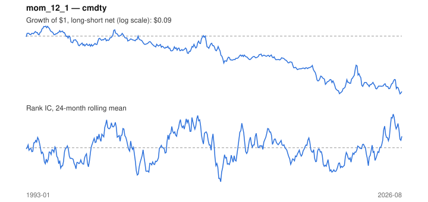

# Signal card: `mom_12_1`

12-month momentum skipping the last 1 month(s). Universe: `cmdty`, 1993-01 to 2026-08 (404 months), net of 10 bp per unit of turnover.

Verdict: **Not promoted** — passes 2 of 6 gates; fails ic_tstat, dsr, pbo, marginal.

## Why it should work

Investors under-react to industry news, so prices drift in the direction of recent performance; Moskowitz & Grinblatt find industry momentum explains much of stock-level momentum.

Reference: Jegadeesh & Titman (1993); Moskowitz & Grinblatt (1999), industry momentum

## Data and timing

- Uses returns through the end of month t; the forecast is month t+1's return.
- Source: Ken French data library (industry portfolios, factors), latest vintage.
- Parameters: `{'lookback': 12, 'skip': 1}`

## Results

| Metric | Value |
|---|---|
| Mean rank IC | 0.001 |
| IC t-stat (Newey-West) | 0.06 |
| IC information ratio (annual) | 0.01 |
| IC hit rate | 52% |
| Long-short return, annual, net | -3.6% |
| Long-short volatility, annual | 25.7% |
| Sharpe, gross / net | -0.10 / -0.14 |
| Sharpe since 2000, net | -0.17 |
| Probabilistic Sharpe (vs 0) | 0.21 |
| Deflated Sharpe (9 trials) | 0.00 |
| Turnover per month | 0.87 |
| Break-even cost | -24 bp |
| Quintile monotonicity | -0.10 |

IC decay (signal at t vs return k months later): 1m +0.001, 2m -0.006, 3m -0.016, 6m -0.048, 12m -0.069

Annual return by quantile: Q1 +8.3%, Q2 +6.0%, Q3 +8.7%, Q4 +8.9%, Q5 +5.8%

## Promotion gates (PRD §8.4)

| Gate | Threshold | Value | Result |
|---|---|---|---|
| IC t-stat | ≥ 2 | 0.06 | fail |
| Deflated Sharpe | ≥ 0.95 | 0.00 | fail |
| Family PBO | < 20% | 46% | fail |
| Regimes with IC > 0 | ≥ 3 of 4 | 3 of 4 | pass |
| Ensemble ICIR contribution | > 0 | -0.069 | fail |
| Economic rationale | reference | yes | pass |

IC by market regime: down_calm +0.018, down_volatile -0.026, up_calm +0.009, up_volatile +0.003

## Every configuration tried (`momentum` family)

PBO across 4 configurations: 46% over 404 common months.

| Configuration | IC | t-stat | Sharpe net | DSR |
|---|---|---|---|---|
| `mom_3_1` | -0.004 | -0.25 | -0.06 | 0.00 |
| `mom_12_1` | 0.001 | 0.06 | -0.14 | 0.00 |
| `mom_6_1` | -0.023 | -1.52 | -0.22 | 0.00 |
| `mom_9_1` | -0.034 | -2.07 | -0.51 | 0.00 |

## Tearsheet



## Where it breaks

- Worst drawdown: -94%, from Oct 1994 to Jun 2026.
- Worst 12 months: -56%, ending Jul 2023.
- Since 2000 the net Sharpe is -0.17 versus -0.14 over the full sample.

## Reproduce

```bash
uv run atlas ingest kenfrench --all
uv run atlas research gates --universe cmdty --exclude-holdout
uv run atlas research signal mom_12_1 --universe cmdty
```

_Generated by `atlas research cards` on 2026-10-26. Do not edit by hand._
