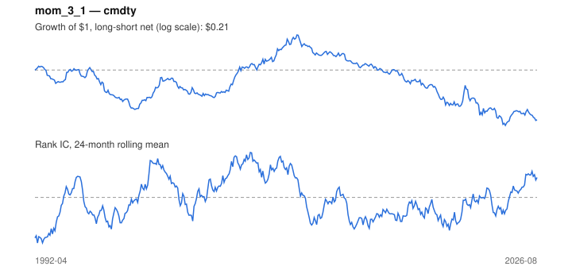

# Signal card: `mom_3_1`

3-month momentum skipping the last 1 month(s). Universe: `cmdty`, 1992-04 to 2026-08 (413 months), net of 10 bp per unit of turnover.

Verdict: **Not promoted** — passes 1 of 6 gates; fails ic_tstat, dsr, pbo, regimes, marginal.

## Why it should work

Investors under-react to industry news, so prices drift in the direction of recent performance; Moskowitz & Grinblatt find industry momentum explains much of stock-level momentum.

Reference: Jegadeesh & Titman (1993); Moskowitz & Grinblatt (1999), industry momentum

## Data and timing

- Uses returns through the end of month t; the forecast is month t+1's return.
- Source: Ken French data library (industry portfolios, factors), latest vintage.
- Parameters: `{'lookback': 3, 'skip': 1}`

## Results

| Metric | Value |
|---|---|
| Mean rank IC | -0.004 |
| IC t-stat (Newey-West) | -0.25 |
| IC information ratio (annual) | -0.05 |
| IC hit rate | 48% |
| Long-short return, annual, net | -1.5% |
| Long-short volatility, annual | 24.5% |
| Sharpe, gross / net | 0.04 / -0.06 |
| Sharpe since 2000, net | 0.02 |
| Probabilistic Sharpe (vs 0) | 0.36 |
| Deflated Sharpe (9 trials) | 0.00 |
| Turnover per month | 1.98 |
| Break-even cost | 4 bp |
| Quintile monotonicity | 0.40 |

IC decay (signal at t vs return k months later): 1m -0.004, 2m -0.013, 3m -0.018, 6m -0.035, 12m -0.048

Annual return by quantile: Q1 +6.1%, Q2 +7.1%, Q3 +7.3%, Q4 +10.0%, Q5 +7.0%

## Promotion gates (PRD §8.4)

| Gate | Threshold | Value | Result |
|---|---|---|---|
| IC t-stat | ≥ 2 | -0.25 | fail |
| Deflated Sharpe | ≥ 0.95 | 0.00 | fail |
| Family PBO | < 20% | 46% | fail |
| Regimes with IC > 0 | ≥ 3 of 4 | 1 of 4 | fail |
| Ensemble ICIR contribution | > 0 | -0.037 | fail |
| Economic rationale | reference | yes | pass |

IC by market regime: down_calm -0.001, down_volatile +0.016, up_calm -0.005, up_volatile -0.015

## Every configuration tried (`momentum` family)

PBO across 4 configurations: 46% over 404 common months.

| Configuration | IC | t-stat | Sharpe net | DSR |
|---|---|---|---|---|
| `mom_3_1` | -0.004 | -0.25 | -0.06 | 0.00 |
| `mom_12_1` | 0.001 | 0.06 | -0.14 | 0.00 |
| `mom_6_1` | -0.023 | -1.52 | -0.22 | 0.00 |
| `mom_9_1` | -0.034 | -2.07 | -0.51 | 0.00 |

## Tearsheet



## Where it breaks

- Worst drawdown: -94%, from Mar 2010 to Jun 2024.
- Worst 12 months: -60%, ending Sep 2022.
- Since 2000 the net Sharpe is 0.02 versus -0.06 over the full sample.

## Reproduce

```bash
uv run atlas ingest kenfrench --all
uv run atlas research gates --universe cmdty --exclude-holdout
uv run atlas research signal mom_3_1 --universe cmdty
```

_Generated by `atlas research cards` on 2026-10-26. Do not edit by hand._
