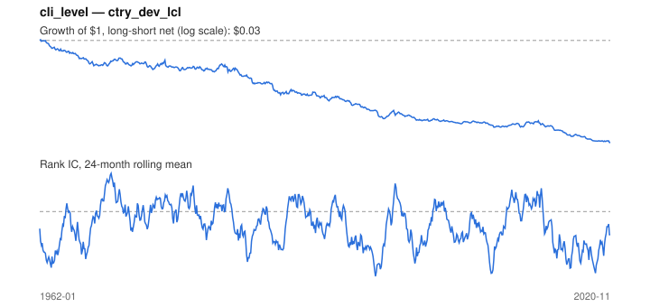

# Signal card: `cli_level`

OECD leading indicator relative to trend (100). Universe: `ctry_dev_lcl`, 1962-01 to 2020-11 (707 months), net of 10 bp per unit of turnover.

Verdict: **Not promoted** — passes 2 of 6 gates; fails ic_tstat, dsr, regimes, marginal.

## Why it should work

No rationale recorded.

Reference: OECD CLI methodology; Stock & Watson (2003) on leading indicators and asset returns

## Data and timing

- Uses returns through the end of month t; the forecast is month t+1's return.
- Source: Ken French data library (industry portfolios, factors), latest vintage.
- Parameters: `{'level': 1}`

## Results

| Metric | Value |
|---|---|
| Mean rank IC | -0.054 |
| IC t-stat (Newey-West) | -3.43 |
| IC information ratio (annual) | -0.47 |
| IC hit rate | 45% |
| Long-short return, annual, net | -5.5% |
| Long-short volatility, annual | 10.5% |
| Sharpe, gross / net | -0.49 / -0.52 |
| Sharpe since 2000, net | -0.63 |
| Probabilistic Sharpe (vs 0) | 0.00 |
| Deflated Sharpe (41 trials) | 0.00 |
| Turnover per month | 0.33 |
| Break-even cost | -130 bp |
| Quintile monotonicity | -1.00 |

IC decay (signal at t vs return k months later): 1m -0.054, 2m -0.071, 3m -0.084, 6m -0.096, 12m -0.079

Annual return by quantile: Q1 +8.2%, Q2 +7.7%, Q3 +3.1%

## Promotion gates (PRD §8.4)

| Gate | Threshold | Value | Result |
|---|---|---|---|
| IC t-stat | ≥ 2 | -3.43 | fail |
| Deflated Sharpe | ≥ 0.95 | 0.00 | fail |
| Family PBO | < 20% | 0% | pass |
| Regimes with IC > 0 | ≥ 3 of 4 | 1 of 4 | fail |
| Ensemble ICIR contribution | > 0 | -0.101 | fail |
| Economic rationale | reference | yes | pass |

IC by market regime: down_calm -0.034, down_volatile -0.036, up_calm -0.109, up_volatile +0.007

## Every configuration tried (`leading_indicator` family)

PBO across 4 configurations: 0% over 695 common months.

| Configuration | IC | t-stat | Sharpe net | DSR |
|---|---|---|---|---|
| `cli_chg_3` | 0.067 | 3.74 | 0.69 | 0.89 |
| `cli_chg_6` | 0.043 | 2.45 | 0.41 | 0.16 |
| `cli_chg_12` | 0.024 | 1.37 | 0.21 | 0.01 |
| `cli_level` | -0.054 | -3.43 | -0.52 | 0.00 |

## Tearsheet



## Where it breaks

- Worst drawdown: -97%, from Feb 1962 to Nov 2020.
- Worst 12 months: -32%, ending Nov 1986.
- Since 2000 the net Sharpe is -0.63 versus -0.52 over the full sample.

## Reproduce

```bash
uv run atlas ingest sdmx --agency oecd --agency ecb
uv run atlas research gates --universe ctry_dev_lcl --exclude-holdout
uv run atlas research signal cli_level --universe ctry_dev_lcl
```

_Generated by `atlas research cards` on 2026-10-21. Do not edit by hand._
