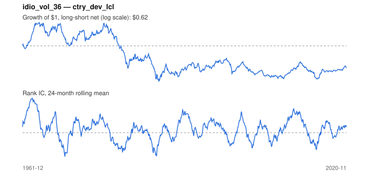

# Signal card: `idio_vol_36`

Negative 36-month residual volatility vs the universe average. Universe: `ctry_dev_lcl`, 1961-12 to 2020-11 (708 months), net of 10 bp per unit of turnover.

Verdict: **Not promoted** — passes 2 of 6 gates; fails ic_tstat, dsr, pbo, regimes.

## Why it should work

No rationale recorded.

Reference: Ang, Hodrick, Xing & Zhang (2006), the cross-section of volatility

## Data and timing

- Uses returns through the end of month t; the forecast is month t+1's return.
- Source: Ken French data library (industry portfolios, factors), latest vintage.
- Parameters: `{'window': 36}`

## Results

| Metric | Value |
|---|---|
| Mean rank IC | 0.031 |
| IC t-stat (Newey-West) | 1.75 |
| IC information ratio (annual) | 0.27 |
| IC hit rate | 52% |
| Long-short return, annual, net | -0.3% |
| Long-short volatility, annual | 10.3% |
| Sharpe, gross / net | -0.00 / -0.03 |
| Sharpe since 2000, net | 0.04 |
| Probabilistic Sharpe (vs 0) | 0.42 |
| Deflated Sharpe (41 trials) | 0.00 |
| Turnover per month | 0.23 |
| Break-even cost | -0 bp |
| Quintile monotonicity | -0.50 |

IC decay (signal at t vs return k months later): 1m +0.031, 2m +0.035, 3m +0.041, 6m +0.048, 12m +0.037

Annual return by quantile: Q1 +5.8%, Q2 +7.5%, Q3 +5.8%

## Promotion gates (PRD §8.4)

| Gate | Threshold | Value | Result |
|---|---|---|---|
| IC t-stat | ≥ 2 | 1.75 | fail |
| Deflated Sharpe | ≥ 0.95 | 0.00 | fail |
| Family PBO | < 20% | 79% | fail |
| Regimes with IC > 0 | ≥ 3 of 4 | 2 of 4 | fail |
| Ensemble ICIR contribution | > 0 | +0.041 | pass |
| Economic rationale | reference | yes | pass |

IC by market regime: down_calm -0.017, down_volatile +0.056, up_calm -0.020, up_volatile +0.047

## Every configuration tried (`idiosyncratic_vol` family)

PBO across 3 configurations: 79% over 676 common months.

| Configuration | IC | t-stat | Sharpe net | DSR |
|---|---|---|---|---|
| `idio_vol_24` | 0.027 | 1.60 | 0.01 | 0.00 |
| `idio_vol_36` | 0.031 | 1.75 | -0.03 | 0.00 |
| `idio_vol_60` | 0.018 | 1.05 | -0.11 | 0.00 |

## Tearsheet



## Where it breaks

- Worst drawdown: -72%, from Dec 1964 to Sep 1986.
- Worst 12 months: -35%, ending Mar 1986.
- Since 2000 the net Sharpe is 0.04 versus -0.03 over the full sample.

## Reproduce

```bash
uv run atlas ingest sdmx --agency oecd --agency ecb
uv run atlas research gates --universe ctry_dev_lcl --exclude-holdout
uv run atlas research signal idio_vol_36 --universe ctry_dev_lcl
```

_Generated by `atlas research cards` on 2026-10-21. Do not edit by hand._
