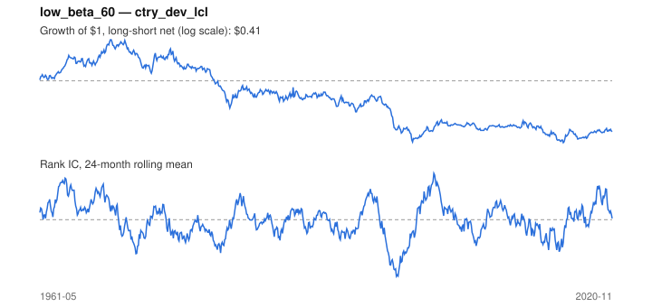

# Signal card: `low_beta_60`

Negative 60-month beta to the universe average (betting against beta). Universe: `ctry_dev_lcl`, 1961-05 to 2020-11 (715 months), net of 10 bp per unit of turnover.

Verdict: **Not promoted** — passes 1 of 6 gates; fails ic_tstat, dsr, pbo, regimes, marginal.

## Why it should work

No rationale recorded.

Reference: Frazzini & Pedersen (2014), betting against beta

## Data and timing

- Uses returns through the end of month t; the forecast is month t+1's return.
- Source: Ken French data library (industry portfolios, factors), latest vintage.
- Parameters: `{'window': 60}`

## Results

| Metric | Value |
|---|---|
| Mean rank IC | -0.000 |
| IC t-stat (Newey-West) | -0.02 |
| IC information ratio (annual) | -0.00 |
| IC hit rate | 50% |
| Long-short return, annual, net | -0.8% |
| Long-short volatility, annual | 11.5% |
| Sharpe, gross / net | -0.06 / -0.07 |
| Sharpe since 2000, net | 0.06 |
| Probabilistic Sharpe (vs 0) | 0.29 |
| Deflated Sharpe (41 trials) | 0.00 |
| Turnover per month | 0.16 |
| Break-even cost | -35 bp |
| Quintile monotonicity | -0.50 |

IC decay (signal at t vs return k months later): 1m -0.000, 2m +0.005, 3m +0.005, 6m +0.009, 12m +0.013

Annual return by quantile: Q1 +7.2%, Q2 +5.3%, Q3 +6.6%

## Promotion gates (PRD §8.4)

| Gate | Threshold | Value | Result |
|---|---|---|---|
| IC t-stat | ≥ 2 | -0.02 | fail |
| Deflated Sharpe | ≥ 0.95 | 0.00 | fail |
| Family PBO | < 20% | 26% | fail |
| Regimes with IC > 0 | ≥ 3 of 4 | 2 of 4 | fail |
| Ensemble ICIR contribution | > 0 | -0.019 | fail |
| Economic rationale | reference | yes | pass |

IC by market regime: down_calm +0.089, down_volatile +0.063, up_calm -0.027, up_volatile -0.059

## Every configuration tried (`low_beta` family)

PBO across 2 configurations: 26% over 715 common months.

| Configuration | IC | t-stat | Sharpe net | DSR |
|---|---|---|---|---|
| `low_beta_36` | 0.007 | 0.40 | 0.06 | 0.00 |
| `low_beta_60` | -0.000 | -0.02 | -0.07 | 0.00 |

## Tearsheet



## Where it breaks

- Worst drawdown: -83%, from Sep 1968 to Oct 2015.
- Worst 12 months: -36%, ending May 1998.
- Since 2000 the net Sharpe is 0.06 versus -0.07 over the full sample.

## Reproduce

```bash
uv run atlas ingest sdmx --agency oecd --agency ecb
uv run atlas research gates --universe ctry_dev_lcl --exclude-holdout
uv run atlas research signal low_beta_60 --universe ctry_dev_lcl
```

_Generated by `atlas research cards` on 2026-10-21. Do not edit by hand._
