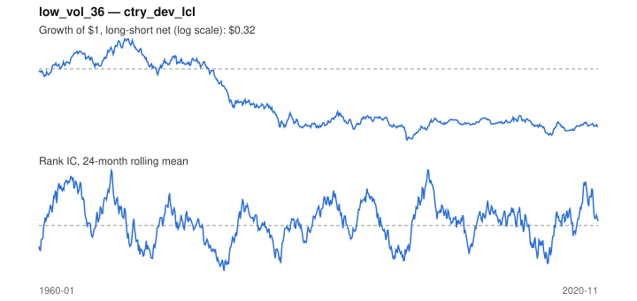

# Signal card: `low_vol_36`

Negative trailing 36-month volatility. Universe: `ctry_dev_lcl`, 1960-01 to 2020-11 (731 months), net of 10 bp per unit of turnover.

Verdict: **Not promoted** — passes 2 of 6 gates; fails ic_tstat, dsr, pbo, regimes.

## Why it should work

Leverage-constrained investors bid up high-beta, high-volatility assets, leaving low-volatility assets with higher risk-adjusted returns.

Reference: Ang, Hodrick, Xing & Zhang (2006); Frazzini & Pedersen (2014)

## Data and timing

- Uses returns through the end of month t; the forecast is month t+1's return.
- Source: Ken French data library (industry portfolios, factors), latest vintage.
- Parameters: `{'window': 36}`

## Results

| Metric | Value |
|---|---|
| Mean rank IC | 0.018 |
| IC t-stat (Newey-West) | 0.99 |
| IC information ratio (annual) | 0.14 |
| IC hit rate | 51% |
| Long-short return, annual, net | -1.2% |
| Long-short volatility, annual | 11.3% |
| Sharpe, gross / net | -0.09 / -0.11 |
| Sharpe since 2000, net | 0.10 |
| Probabilistic Sharpe (vs 0) | 0.20 |
| Deflated Sharpe (41 trials) | 0.00 |
| Turnover per month | 0.20 |
| Break-even cost | -40 bp |
| Quintile monotonicity | -0.50 |

IC decay (signal at t vs return k months later): 1m +0.018, 2m +0.023, 3m +0.028, 6m +0.033, 12m +0.032

Annual return by quantile: Q1 +7.2%, Q2 +5.9%, Q3 +6.2%

## Promotion gates (PRD §8.4)

| Gate | Threshold | Value | Result |
|---|---|---|---|
| IC t-stat | ≥ 2 | 0.99 | fail |
| Deflated Sharpe | ≥ 0.95 | 0.00 | fail |
| Family PBO | < 20% | 28% | fail |
| Regimes with IC > 0 | ≥ 3 of 4 | 2 of 4 | fail |
| Ensemble ICIR contribution | > 0 | +0.010 | pass |
| Economic rationale | reference | yes | pass |

IC by market regime: down_calm +0.072, down_volatile +0.069, up_calm -0.015, up_volatile -0.020

## Every configuration tried (`low_volatility` family)

PBO across 3 configurations: 28% over 715 common months.

| Configuration | IC | t-stat | Sharpe net | DSR |
|---|---|---|---|---|
| `low_vol_60` | 0.026 | 1.44 | 0.01 | 0.00 |
| `low_vol_24` | 0.009 | 0.52 | -0.09 | 0.00 |
| `low_vol_36` | 0.018 | 0.99 | -0.11 | 0.00 |

## Tearsheet



## Where it breaks

- Worst drawdown: -86%, from May 1969 to Feb 2000.
- Worst 12 months: -34%, ending Feb 1981.
- Since 2000 the net Sharpe is 0.10 versus -0.11 over the full sample.

## Reproduce

```bash
uv run atlas ingest sdmx --agency oecd --agency ecb
uv run atlas research gates --universe ctry_dev_lcl --exclude-holdout
uv run atlas research signal low_vol_36 --universe ctry_dev_lcl
```

_Generated by `atlas research cards` on 2026-10-21. Do not edit by hand._
