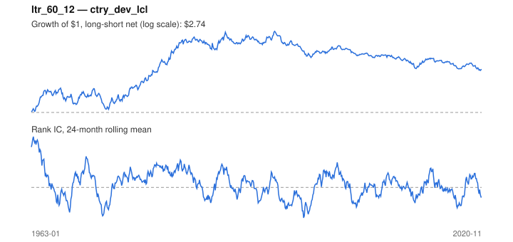

# Signal card: `ltr_60_12`

Negative 60-month return skipping the last 12 months. Universe: `ctry_dev_lcl`, 1963-01 to 2020-11 (695 months), net of 10 bp per unit of turnover.

Verdict: **Not promoted** — passes 3 of 6 gates; fails ic_tstat, dsr, pbo.

## Why it should work

Investors over-extrapolate multi-year performance; long-run losers become too cheap and mean-revert.

Reference: De Bondt & Thaler (1985)

## Data and timing

- Uses returns through the end of month t; the forecast is month t+1's return.
- Source: Ken French data library (industry portfolios, factors), latest vintage.
- Parameters: `{'lookback': 60, 'skip': 12}`

## Results

| Metric | Value |
|---|---|
| Mean rank IC | 0.020 |
| IC t-stat (Newey-West) | 1.16 |
| IC information ratio (annual) | 0.17 |
| IC hit rate | 50% |
| Long-short return, annual, net | 2.3% |
| Long-short volatility, annual | 11.0% |
| Sharpe, gross / net | 0.26 / 0.21 |
| Sharpe since 2000, net | -0.28 |
| Probabilistic Sharpe (vs 0) | 0.95 |
| Deflated Sharpe (41 trials) | 0.01 |
| Turnover per month | 0.41 |
| Break-even cost | 58 bp |
| Quintile monotonicity | 0.50 |

IC decay (signal at t vs return k months later): 1m +0.020, 2m +0.019, 3m +0.023, 6m +0.020, 12m +0.026

Annual return by quantile: Q1 +5.0%, Q2 +7.9%, Q3 +7.8%

## Promotion gates (PRD §8.4)

| Gate | Threshold | Value | Result |
|---|---|---|---|
| IC t-stat | ≥ 2 | 1.16 | fail |
| Deflated Sharpe | ≥ 0.95 | 0.01 | fail |
| Family PBO | < 20% | 80% | fail |
| Regimes with IC > 0 | ≥ 3 of 4 | 3 of 4 | pass |
| Ensemble ICIR contribution | > 0 | +0.021 | pass |
| Economic rationale | reference | yes | pass |

IC by market regime: down_calm +0.032, down_volatile +0.065, up_calm -0.007, up_volatile +0.006

## Every configuration tried (`long_term_reversal` family)

PBO across 2 configurations: 80% over 695 common months.

| Configuration | IC | t-stat | Sharpe net | DSR |
|---|---|---|---|---|
| `ltr_36_12` | 0.022 | 1.24 | 0.26 | 0.01 |
| `ltr_60_12` | 0.020 | 1.16 | 0.21 | 0.01 |

## Tearsheet



## Where it breaks

- Worst drawdown: -60%, from Apr 1994 to Sep 2020.
- Worst 12 months: -31%, ending Sep 1972.
- Since 2000 the net Sharpe is -0.28 versus 0.21 over the full sample.

## Reproduce

```bash
uv run atlas ingest sdmx --agency oecd --agency ecb
uv run atlas research gates --universe ctry_dev_lcl --exclude-holdout
uv run atlas research signal ltr_60_12 --universe ctry_dev_lcl
```

_Generated by `atlas research cards` on 2026-10-21. Do not edit by hand._
