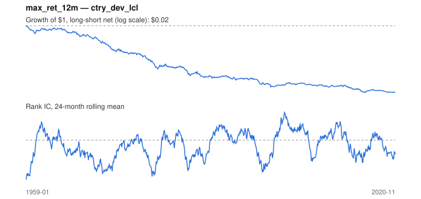

# Signal card: `max_ret_12m`

Negative maximum monthly return over 12 months (avoid lotteries). Universe: `ctry_dev_lcl`, 1959-01 to 2020-11 (743 months), net of 10 bp per unit of turnover.

Verdict: **Not promoted** — passes 1 of 6 gates; fails ic_tstat, dsr, pbo, regimes, marginal.

## Why it should work

No rationale recorded.

Reference: Bali, Cakici & Whitelaw (2011), maxing out

## Data and timing

- Uses returns through the end of month t; the forecast is month t+1's return.
- Source: Ken French data library (industry portfolios, factors), latest vintage.
- Parameters: `{'months': 12}`

## Results

| Metric | Value |
|---|---|
| Mean rank IC | -0.039 |
| IC t-stat (Newey-West) | -2.45 |
| IC information ratio (annual) | -0.35 |
| IC hit rate | 42% |
| Long-short return, annual, net | -6.0% |
| Long-short volatility, annual | 10.5% |
| Sharpe, gross / net | -0.53 / -0.57 |
| Sharpe since 2000, net | -0.27 |
| Probabilistic Sharpe (vs 0) | 0.00 |
| Deflated Sharpe (41 trials) | 0.00 |
| Turnover per month | 0.38 |
| Break-even cost | -120 bp |
| Quintile monotonicity | -1.00 |

IC decay (signal at t vs return k months later): 1m -0.039, 2m -0.016, 3m -0.007, 6m +0.017, 12m +0.026

Annual return by quantile: Q1 +9.5%, Q2 +6.7%, Q3 +4.0%

## Promotion gates (PRD §8.4)

| Gate | Threshold | Value | Result |
|---|---|---|---|
| IC t-stat | ≥ 2 | -2.45 | fail |
| Deflated Sharpe | ≥ 0.95 | 0.00 | fail |
| Family PBO | < 20% | 68% | fail |
| Regimes with IC > 0 | ≥ 3 of 4 | 2 of 4 | fail |
| Ensemble ICIR contribution | > 0 | -0.029 | fail |
| Economic rationale | reference | yes | pass |

IC by market regime: down_calm +0.059, down_volatile +0.010, up_calm -0.058, up_volatile -0.072

## Every configuration tried (`lottery` family)

PBO across 2 configurations: 68% over 743 common months.

| Configuration | IC | t-stat | Sharpe net | DSR |
|---|---|---|---|---|
| `max_ret_12m` | -0.039 | -2.45 | -0.57 | 0.00 |
| `max_ret_6m` | -0.054 | -3.30 | -0.62 | 0.00 |

## Tearsheet



## Where it breaks

- Worst drawdown: -98%, from Feb 1959 to Oct 2015.
- Worst 12 months: -38%, ending Feb 1981.
- Since 2000 the net Sharpe is -0.27 versus -0.57 over the full sample.

## Reproduce

```bash
uv run atlas ingest sdmx --agency oecd --agency ecb
uv run atlas research gates --universe ctry_dev_lcl --exclude-holdout
uv run atlas research signal max_ret_12m --universe ctry_dev_lcl
```

_Generated by `atlas research cards` on 2026-10-21. Do not edit by hand._
