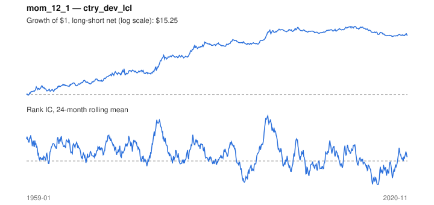

# Signal card: `mom_12_1`

12-month momentum skipping the last 1 month(s). Universe: `ctry_dev_lcl`, 1959-01 to 2020-11 (743 months), net of 10 bp per unit of turnover.

Verdict: **Not promoted** — passes 5 of 6 gates; fails dsr.

## Why it should work

Investors under-react to industry news, so prices drift in the direction of recent performance; Moskowitz & Grinblatt find industry momentum explains much of stock-level momentum.

Reference: Jegadeesh & Titman (1993); Moskowitz & Grinblatt (1999), industry momentum

## Data and timing

- Uses returns through the end of month t; the forecast is month t+1's return.
- Source: Ken French data library (industry portfolios, factors), latest vintage.
- Parameters: `{'lookback': 12, 'skip': 1}`

## Results

| Metric | Value |
|---|---|
| Mean rank IC | 0.055 |
| IC t-stat (Newey-West) | 3.39 |
| IC information ratio (annual) | 0.47 |
| IC hit rate | 56% |
| Long-short return, annual, net | 5.1% |
| Long-short volatility, annual | 11.4% |
| Sharpe, gross / net | 0.52 / 0.44 |
| Sharpe since 2000, net | -0.12 |
| Probabilistic Sharpe (vs 0) | 1.00 |
| Deflated Sharpe (41 trials) | 0.23 |
| Turnover per month | 0.72 |
| Break-even cost | 69 bp |
| Quintile monotonicity | 1.00 |

IC decay (signal at t vs return k months later): 1m +0.055, 2m +0.058, 3m +0.040, 6m +0.017, 12m -0.005

Annual return by quantile: Q1 +4.2%, Q2 +7.2%, Q3 +10.1%

## Promotion gates (PRD §8.4)

| Gate | Threshold | Value | Result |
|---|---|---|---|
| IC t-stat | ≥ 2 | 3.39 | pass |
| Deflated Sharpe | ≥ 0.95 | 0.23 | fail |
| Family PBO | < 20% | 1% | pass |
| Regimes with IC > 0 | ≥ 3 of 4 | 3 of 4 | pass |
| Ensemble ICIR contribution | > 0 | +0.029 | pass |
| Economic rationale | reference | yes | pass |

IC by market regime: down_calm -0.041, down_volatile +0.049, up_calm +0.024, up_volatile +0.093

## Every configuration tried (`momentum` family)

PBO across 5 configurations: 1% over 737 common months.

| Configuration | IC | t-stat | Sharpe net | DSR |
|---|---|---|---|---|
| `mom_12_1` | 0.055 | 3.39 | 0.44 | 0.23 |
| `mom_9_1` | 0.038 | 2.34 | 0.26 | 0.01 |
| `mom_6_1` | 0.033 | 1.93 | 0.17 | 0.00 |
| `mom_18_1` | 0.026 | 1.44 | 0.10 | 0.00 |
| `mom_3_1` | -0.006 | -0.37 | -0.16 | 0.00 |

## Tearsheet



## Where it breaks

- Worst drawdown: -37%, from Jun 2012 to Jun 2018.
- Worst 12 months: -20%, ending Jul 1962.
- Since 2000 the net Sharpe is -0.12 versus 0.44 over the full sample.

## Reproduce

```bash
uv run atlas ingest sdmx --agency oecd --agency ecb
uv run atlas research gates --universe ctry_dev_lcl --exclude-holdout
uv run atlas research signal mom_12_1 --universe ctry_dev_lcl
```

_Generated by `atlas research cards` on 2026-10-21. Do not edit by hand._
