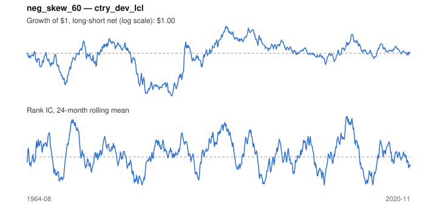

# Signal card: `neg_skew_60`

Negative 60-month return skewness. Universe: `ctry_dev_lcl`, 1964-08 to 2020-11 (676 months), net of 10 bp per unit of turnover.

Verdict: **Not promoted** — passes 1 of 6 gates; fails ic_tstat, dsr, pbo, regimes, marginal.

## Why it should work

No rationale recorded.

Reference: Harvey & Siddique (2000); Amaya et al. (2015) on realized skewness

## Data and timing

- Uses returns through the end of month t; the forecast is month t+1's return.
- Source: Ken French data library (industry portfolios, factors), latest vintage.
- Parameters: `{'window': 60}`

## Results

| Metric | Value |
|---|---|
| Mean rank IC | 0.016 |
| IC t-stat (Newey-West) | 0.96 |
| IC information ratio (annual) | 0.14 |
| IC hit rate | 50% |
| Long-short return, annual, net | 0.6% |
| Long-short volatility, annual | 10.9% |
| Sharpe, gross / net | 0.09 / 0.05 |
| Sharpe since 2000, net | -0.01 |
| Probabilistic Sharpe (vs 0) | 0.66 |
| Deflated Sharpe (41 trials) | 0.00 |
| Turnover per month | 0.31 |
| Break-even cost | 26 bp |
| Quintile monotonicity | 0.50 |

IC decay (signal at t vs return k months later): 1m +0.016, 2m +0.031, 3m +0.028, 6m +0.035, 12m +0.052

Annual return by quantile: Q1 +6.1%, Q2 +7.5%, Q3 +7.0%

## Promotion gates (PRD §8.4)

| Gate | Threshold | Value | Result |
|---|---|---|---|
| IC t-stat | ≥ 2 | 0.96 | fail |
| Deflated Sharpe | ≥ 0.95 | 0.00 | fail |
| Family PBO | < 20% | 23% | fail |
| Regimes with IC > 0 | ≥ 3 of 4 | 2 of 4 | fail |
| Ensemble ICIR contribution | > 0 | -0.008 | fail |
| Economic rationale | reference | yes | pass |

IC by market regime: down_calm -0.000, down_volatile +0.043, up_calm +0.016, up_volatile -0.001

## Every configuration tried (`skewness` family)

PBO across 2 configurations: 23% over 676 common months.

| Configuration | IC | t-stat | Sharpe net | DSR |
|---|---|---|---|---|
| `neg_skew_60` | 0.016 | 0.96 | 0.05 | 0.00 |
| `neg_skew_36` | -0.013 | -0.74 | -0.15 | 0.00 |

## Tearsheet



## Where it breaks

- Worst drawdown: -54%, from Sep 1976 to Nov 1985.
- Worst 12 months: -32%, ending Mar 1981.
- Since 2000 the net Sharpe is -0.01 versus 0.05 over the full sample.

## Reproduce

```bash
uv run atlas ingest sdmx --agency oecd --agency ecb
uv run atlas research gates --universe ctry_dev_lcl --exclude-holdout
uv run atlas research signal neg_skew_60 --universe ctry_dev_lcl
```

_Generated by `atlas research cards` on 2026-10-21. Do not edit by hand._
