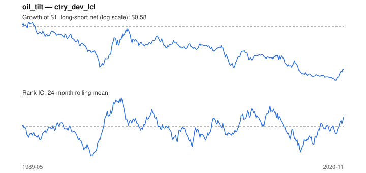

# Signal card: `oil_tilt`

Sensitivity to oil (60-month beta) times its 3-month move. Universe: `ctry_dev_lcl`, 1989-05 to 2020-11 (379 months), net of 10 bp per unit of turnover.

Verdict: **Not promoted** — passes 2 of 6 gates; fails ic_tstat, dsr, pbo, regimes.

## Why it should work

No rationale recorded.

Reference: PRD §6.4 macro-to-sector sensitivity; Moskowitz, Ooi & Pedersen (2012) on trend persistence

## Data and timing

- Uses returns through the end of month t; the forecast is month t+1's return.
- Source: Ken French data library (industry portfolios, factors), latest vintage.
- Parameters: `{'window': 60, 'trend': 3}`

## Results

| Metric | Value |
|---|---|
| Mean rank IC | -0.007 |
| IC t-stat (Newey-West) | -0.30 |
| IC information ratio (annual) | -0.06 |
| IC hit rate | 51% |
| Long-short return, annual, net | -1.4% |
| Long-short volatility, annual | 7.3% |
| Sharpe, gross / net | -0.01 / -0.20 |
| Sharpe since 2000, net | -0.30 |
| Probabilistic Sharpe (vs 0) | 0.13 |
| Deflated Sharpe (41 trials) | 0.00 |
| Turnover per month | 1.15 |
| Break-even cost | -1 bp |
| Quintile monotonicity | -0.50 |

IC decay (signal at t vs return k months later): 1m -0.007, 2m -0.024, 3m -0.019, 6m +0.002, 12m -0.018

Annual return by quantile: Q1 +5.2%, Q2 +4.1%, Q3 +5.1%

## Promotion gates (PRD §8.4)

| Gate | Threshold | Value | Result |
|---|---|---|---|
| IC t-stat | ≥ 2 | -0.30 | fail |
| Deflated Sharpe | ≥ 0.95 | 0.00 | fail |
| Family PBO | < 20% | 82% | fail |
| Regimes with IC > 0 | ≥ 3 of 4 | 1 of 4 | fail |
| Ensemble ICIR contribution | > 0 | +0.016 | pass |
| Economic rationale | reference | yes | pass |

IC by market regime: down_calm -0.047, down_volatile -0.040, up_calm -0.039, up_volatile +0.081

## Every configuration tried (`oil_tilt` family)

PBO across 4 configurations: 82% over 379 common months.

| Configuration | IC | t-stat | Sharpe net | DSR |
|---|---|---|---|---|
| `oil_tilt_60_1` | 0.027 | 1.44 | -0.07 | 0.00 |
| `oil_tilt_36_3` | -0.001 | -0.05 | -0.18 | 0.00 |
| `oil_tilt_36_1` | 0.025 | 1.22 | -0.18 | 0.00 |
| `oil_tilt` | -0.007 | -0.30 | -0.20 | 0.00 |

## Tearsheet



## Where it breaks

- Worst drawdown: -52%, from Jan 1990 to Jan 2020.
- Worst 12 months: -21%, ending Jan 2010.
- Since 2000 the net Sharpe is -0.30 versus -0.20 over the full sample.

## Reproduce

```bash
uv run atlas ingest sdmx --agency oecd --agency ecb
uv run atlas research gates --universe ctry_dev_lcl --exclude-holdout
uv run atlas research signal oil_tilt --universe ctry_dev_lcl
```

_Generated by `atlas research cards` on 2026-10-21. Do not edit by hand._
