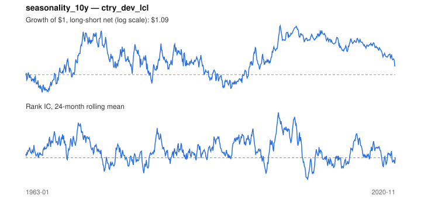

# Signal card: `seasonality_10y`

Average return in the coming calendar month over the past 10 years. Universe: `ctry_dev_lcl`, 1963-01 to 2020-11 (695 months), net of 10 bp per unit of turnover.

Verdict: **Not promoted** — passes 4 of 6 gates; fails dsr, pbo.

## Why it should work

No rationale recorded.

Reference: Heston & Sadka (2008), seasonality in the cross-section of returns

## Data and timing

- Uses returns through the end of month t; the forecast is month t+1's return.
- Source: Ken French data library (industry portfolios, factors), latest vintage.
- Parameters: `{'years': 10}`

## Results

| Metric | Value |
|---|---|
| Mean rank IC | 0.046 |
| IC t-stat (Newey-West) | 3.19 |
| IC information ratio (annual) | 0.41 |
| IC hit rate | 54% |
| Long-short return, annual, net | 0.7% |
| Long-short volatility, annual | 10.5% |
| Sharpe, gross / net | 0.35 / 0.07 |
| Sharpe since 2000, net | 0.01 |
| Probabilistic Sharpe (vs 0) | 0.69 |
| Deflated Sharpe (41 trials) | 0.00 |
| Turnover per month | 2.44 |
| Break-even cost | 12 bp |
| Quintile monotonicity | 1.00 |

IC decay (signal at t vs return k months later): 1m +0.046, 2m -0.035, 3m -0.044, 6m -0.003, 12m +0.037

Annual return by quantile: Q1 +5.0%, Q2 +6.5%, Q3 +8.7%

## Promotion gates (PRD §8.4)

| Gate | Threshold | Value | Result |
|---|---|---|---|
| IC t-stat | ≥ 2 | 3.19 | pass |
| Deflated Sharpe | ≥ 0.95 | 0.00 | fail |
| Family PBO | < 20% | 77% | fail |
| Regimes with IC > 0 | ≥ 3 of 4 | 4 of 4 | pass |
| Ensemble ICIR contribution | > 0 | +0.093 | pass |
| Economic rationale | reference | yes | pass |

IC by market regime: down_calm +0.060, down_volatile +0.053, up_calm +0.049, up_volatile +0.033

## Every configuration tried (`seasonality` family)

PBO across 3 configurations: 77% over 635 common months.

| Configuration | IC | t-stat | Sharpe net | DSR |
|---|---|---|---|---|
| `seasonality_10y` | 0.046 | 3.19 | 0.07 | 0.00 |
| `seasonality_20y` | 0.042 | 2.69 | 0.04 | 0.00 |
| `seasonality_5y` | 0.026 | 1.61 | -0.08 | 0.00 |

## Tearsheet



## Where it breaks

- Worst drawdown: -43%, from Nov 1974 to Feb 1995.
- Worst 12 months: -24%, ending Oct 1982.
- Since 2000 the net Sharpe is 0.01 versus 0.07 over the full sample.

## Reproduce

```bash
uv run atlas ingest sdmx --agency oecd --agency ecb
uv run atlas research gates --universe ctry_dev_lcl --exclude-holdout
uv run atlas research signal seasonality_10y --universe ctry_dev_lcl
```

_Generated by `atlas research cards` on 2026-10-21. Do not edit by hand._
