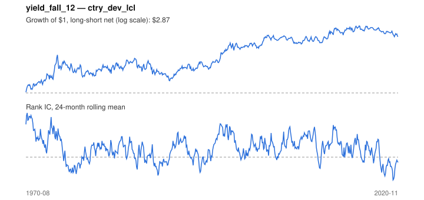

# Signal card: `yield_fall_12`

Fall in the 10-year government yield over 12 months. Universe: `ctry_dev_lcl`, 1970-08 to 2020-11 (604 months), net of 10 bp per unit of turnover.

Verdict: **Not promoted** — passes 5 of 6 gates; fails dsr.

## Why it should work

No rationale recorded.

Reference: Campbell & Ammer (1993); discount-rate channel of equity returns

## Data and timing

- Uses returns through the end of month t; the forecast is month t+1's return.
- Source: Ken French data library (industry portfolios, factors), latest vintage.
- Parameters: `{'months': 12}`

## Results

| Metric | Value |
|---|---|
| Mean rank IC | 0.047 |
| IC t-stat (Newey-West) | 2.91 |
| IC information ratio (annual) | 0.38 |
| IC hit rate | 53% |
| Long-short return, annual, net | 2.7% |
| Long-short volatility, annual | 11.0% |
| Sharpe, gross / net | 0.33 / 0.25 |
| Sharpe since 2000, net | 0.16 |
| Probabilistic Sharpe (vs 0) | 0.96 |
| Deflated Sharpe (41 trials) | 0.02 |
| Turnover per month | 0.74 |
| Break-even cost | 40 bp |
| Quintile monotonicity | 1.00 |

IC decay (signal at t vs return k months later): 1m +0.047, 2m +0.030, 3m +0.017, 6m +0.018, 12m -0.002

Annual return by quantile: Q1 +4.8%, Q2 +7.6%, Q3 +8.4%

## Promotion gates (PRD §8.4)

| Gate | Threshold | Value | Result |
|---|---|---|---|
| IC t-stat | ≥ 2 | 2.91 | pass |
| Deflated Sharpe | ≥ 0.95 | 0.02 | fail |
| Family PBO | < 20% | 10% | pass |
| Regimes with IC > 0 | ≥ 3 of 4 | 4 of 4 | pass |
| Ensemble ICIR contribution | > 0 | +0.028 | pass |
| Economic rationale | reference | yes | pass |

IC by market regime: down_calm +0.021, down_volatile +0.061, up_calm +0.038, up_volatile +0.055

## Every configuration tried (`rates` family)

PBO across 2 configurations: 10% over 604 common months.

| Configuration | IC | t-stat | Sharpe net | DSR |
|---|---|---|---|---|
| `yield_fall_12` | 0.047 | 2.91 | 0.25 | 0.02 |
| `yield_fall_6` | 0.021 | 1.13 | -0.07 | 0.00 |

## Tearsheet



## Where it breaks

- Worst drawdown: -38%, from Nov 1974 to Jan 1990.
- Worst 12 months: -22%, ending Apr 1986.
- Since 2000 the net Sharpe is 0.16 versus 0.25 over the full sample.

## Reproduce

```bash
uv run atlas ingest sdmx --agency oecd --agency ecb
uv run atlas research gates --universe ctry_dev_lcl --exclude-holdout
uv run atlas research signal yield_fall_12 --universe ctry_dev_lcl
```

_Generated by `atlas research cards` on 2026-10-21. Do not edit by hand._
