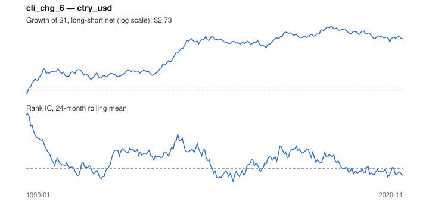

# Signal card: `cli_chg_6`

6-month change in the OECD leading indicator (improving growth). Universe: `ctry_usd`, 1999-01 to 2020-11 (263 months), net of 10 bp per unit of turnover.

Verdict: **Not promoted** — passes 5 of 6 gates; fails dsr.

## Why it should work

No rationale recorded.

Reference: OECD CLI methodology; Stock & Watson (2003) on leading indicators and asset returns

## Data and timing

- Uses returns through the end of month t; the forecast is month t+1's return.
- Source: Ken French data library (industry portfolios, factors), latest vintage.
- Parameters: `{'months': 6}`

## Results

| Metric | Value |
|---|---|
| Mean rank IC | 0.048 |
| IC t-stat (Newey-West) | 2.26 |
| IC information ratio (annual) | 0.50 |
| IC hit rate | 56% |
| Long-short return, annual, net | 5.1% |
| Long-short volatility, annual | 10.5% |
| Sharpe, gross / net | 0.55 / 0.49 |
| Sharpe since 2000, net | 0.37 |
| Probabilistic Sharpe (vs 0) | 0.99 |
| Deflated Sharpe (43 trials) | 0.15 |
| Turnover per month | 0.53 |
| Break-even cost | 91 bp |
| Quintile monotonicity | 0.50 |

IC decay (signal at t vs return k months later): 1m +0.048, 2m +0.017, 3m -0.007, 6m -0.050, 12m -0.058

Annual return by quantile: Q1 +5.1%, Q2 +4.1%, Q3 +10.9%

## Promotion gates (PRD §8.4)

| Gate | Threshold | Value | Result |
|---|---|---|---|
| IC t-stat | ≥ 2 | 2.26 | pass |
| Deflated Sharpe | ≥ 0.95 | 0.15 | fail |
| Family PBO | < 20% | 0% | pass |
| Regimes with IC > 0 | ≥ 3 of 4 | 3 of 4 | pass |
| Ensemble ICIR contribution | > 0 | +0.100 | pass |
| Economic rationale | reference | yes | pass |

IC by market regime: down_calm +0.218, down_volatile -0.030, up_calm +0.072, up_volatile +0.053

## Every configuration tried (`leading_indicator` family)

PBO across 4 configurations: 0% over 263 common months.

| Configuration | IC | t-stat | Sharpe net | DSR |
|---|---|---|---|---|
| `cli_chg_3` | 0.085 | 4.04 | 0.93 | 0.86 |
| `cli_chg_6` | 0.048 | 2.26 | 0.49 | 0.15 |
| `cli_chg_12` | -0.007 | -0.37 | -0.11 | 0.00 |
| `cli_level` | -0.056 | -3.04 | -0.53 | 0.00 |

## Tearsheet



## Where it breaks

- Worst drawdown: -26%, from Sep 2016 to Feb 2020.
- Worst 12 months: -13%, ending Oct 2010.
- Since 2000 the net Sharpe is 0.37 versus 0.49 over the full sample.

## Reproduce

```bash
uv run atlas ingest sdmx --agency oecd --agency ecb
uv run atlas research gates --universe ctry_usd --exclude-holdout
uv run atlas research signal cli_chg_6 --universe ctry_usd
```

_Generated by `atlas research cards` on 2026-10-21. Do not edit by hand._
