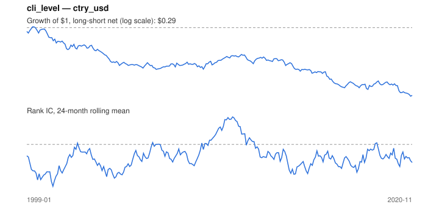

# Signal card: `cli_level`

OECD leading indicator relative to trend (100). Universe: `ctry_usd`, 1999-01 to 2020-11 (263 months), net of 10 bp per unit of turnover.

Verdict: **Not promoted** — passes 2 of 6 gates; fails ic_tstat, dsr, regimes, marginal.

## Why it should work

No rationale recorded.

Reference: OECD CLI methodology; Stock & Watson (2003) on leading indicators and asset returns

## Data and timing

- Uses returns through the end of month t; the forecast is month t+1's return.
- Source: Ken French data library (industry portfolios, factors), latest vintage.
- Parameters: `{'level': 1}`

## Results

| Metric | Value |
|---|---|
| Mean rank IC | -0.056 |
| IC t-stat (Newey-West) | -3.04 |
| IC information ratio (annual) | -0.61 |
| IC hit rate | 45% |
| Long-short return, annual, net | -5.2% |
| Long-short volatility, annual | 9.7% |
| Sharpe, gross / net | -0.49 / -0.53 |
| Sharpe since 2000, net | -0.56 |
| Probabilistic Sharpe (vs 0) | 0.01 |
| Deflated Sharpe (43 trials) | 0.00 |
| Turnover per month | 0.35 |
| Break-even cost | -114 bp |
| Quintile monotonicity | -1.00 |

IC decay (signal at t vs return k months later): 1m -0.056, 2m -0.075, 3m -0.086, 6m -0.087, 12m -0.044

Annual return by quantile: Q1 +8.4%, Q2 +6.6%, Q3 +3.6%

## Promotion gates (PRD §8.4)

| Gate | Threshold | Value | Result |
|---|---|---|---|
| IC t-stat | ≥ 2 | -3.04 | fail |
| Deflated Sharpe | ≥ 0.95 | 0.00 | fail |
| Family PBO | < 20% | 0% | pass |
| Regimes with IC > 0 | ≥ 3 of 4 | 0 of 4 | fail |
| Ensemble ICIR contribution | > 0 | -0.130 | fail |
| Economic rationale | reference | yes | pass |

IC by market regime: down_calm -0.006, down_volatile -0.068, up_calm -0.046, up_volatile -0.068

## Every configuration tried (`leading_indicator` family)

PBO across 4 configurations: 0% over 263 common months.

| Configuration | IC | t-stat | Sharpe net | DSR |
|---|---|---|---|---|
| `cli_chg_3` | 0.085 | 4.04 | 0.93 | 0.86 |
| `cli_chg_6` | 0.048 | 2.26 | 0.49 | 0.15 |
| `cli_chg_12` | -0.007 | -0.37 | -0.11 | 0.00 |
| `cli_level` | -0.056 | -3.04 | -0.53 | 0.00 |

## Tearsheet



## Where it breaks

- Worst drawdown: -72%, from May 1999 to Oct 2020.
- Worst 12 months: -25%, ending Dec 2016.
- Since 2000 the net Sharpe is -0.56 versus -0.53 over the full sample.

## Reproduce

```bash
uv run atlas ingest sdmx --agency oecd --agency ecb
uv run atlas research gates --universe ctry_usd --exclude-holdout
uv run atlas research signal cli_level --universe ctry_usd
```

_Generated by `atlas research cards` on 2026-10-21. Do not edit by hand._
