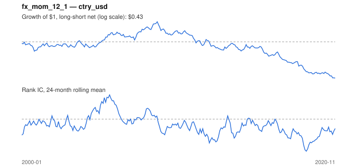

# Signal card: `fx_mom_12_1`

12-month momentum of the local currency vs the US dollar. Universe: `ctry_usd`, 2000-01 to 2020-11 (251 months), net of 10 bp per unit of turnover.

Verdict: **Not promoted** — passes 1 of 6 gates; fails ic_tstat, dsr, pbo, regimes, marginal.

## Why it should work

No rationale recorded.

Reference: Menkhoff, Sarno, Schmeling & Schrimpf (2012), currency momentum

## Data and timing

- Uses returns through the end of month t; the forecast is month t+1's return.
- Source: Ken French data library (industry portfolios, factors), latest vintage.
- Parameters: `{'lookback': 12, 'skip': 1}`

## Results

| Metric | Value |
|---|---|
| Mean rank IC | -0.042 |
| IC t-stat (Newey-West) | -1.72 |
| IC information ratio (annual) | -0.40 |
| IC hit rate | 46% |
| Long-short return, annual, net | -3.3% |
| Long-short volatility, annual | 11.6% |
| Sharpe, gross / net | -0.19 / -0.29 |
| Sharpe since 2000, net | -0.29 |
| Probabilistic Sharpe (vs 0) | 0.10 |
| Deflated Sharpe (43 trials) | 0.00 |
| Turnover per month | 0.91 |
| Break-even cost | -20 bp |
| Quintile monotonicity | -0.50 |

IC decay (signal at t vs return k months later): 1m -0.042, 2m -0.033, 3m -0.037, 6m -0.021, 12m -0.017

Annual return by quantile: Q1 +7.9%, Q2 +4.5%, Q3 +5.7%

## Promotion gates (PRD §8.4)

| Gate | Threshold | Value | Result |
|---|---|---|---|
| IC t-stat | ≥ 2 | -1.72 | fail |
| Deflated Sharpe | ≥ 0.95 | 0.00 | fail |
| Family PBO | < 20% | 72% | fail |
| Regimes with IC > 0 | ≥ 3 of 4 | 1 of 4 | fail |
| Ensemble ICIR contribution | > 0 | -0.035 | fail |
| Economic rationale | reference | yes | pass |

IC by market regime: down_calm +0.055, down_volatile -0.087, up_calm -0.026, up_volatile -0.043

## Every configuration tried (`currency_momentum` family)

PBO across 2 configurations: 72% over 251 common months.

| Configuration | IC | t-stat | Sharpe net | DSR |
|---|---|---|---|---|
| `fx_mom_12_1` | -0.042 | -1.72 | -0.29 | 0.00 |
| `fx_mom_6_1` | -0.031 | -1.26 | -0.43 | 0.00 |

## Tearsheet



## Where it breaks

- Worst drawdown: -73%, from Jan 2009 to Nov 2020.
- Worst 12 months: -26%, ending Jan 2010.
- Since 2000 the net Sharpe is -0.29 versus -0.29 over the full sample.

## Reproduce

```bash
uv run atlas ingest sdmx --agency oecd --agency ecb
uv run atlas research gates --universe ctry_usd --exclude-holdout
uv run atlas research signal fx_mom_12_1 --universe ctry_usd
```

_Generated by `atlas research cards` on 2026-10-21. Do not edit by hand._
