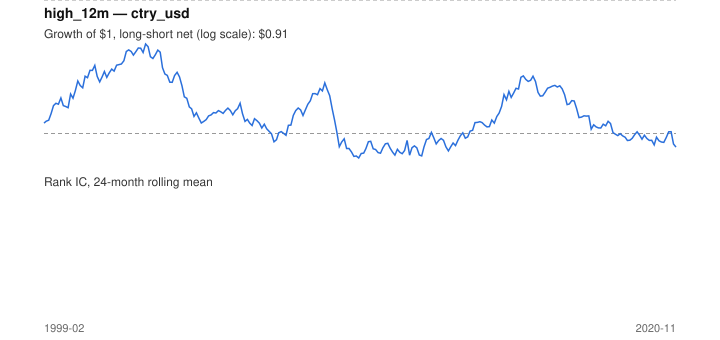

# Signal card: `high_12m`

Distance (log) below the 12-month high of the return index. Universe: `ctry_usd`, 1999-02 to 2020-11 (262 months), net of 10 bp per unit of turnover.

Verdict: **Not promoted** — passes 2 of 6 gates; fails ic_tstat, dsr, pbo, regimes.

## Why it should work

No rationale recorded.

Reference: George & Hwang (2004), the 52-week high and momentum investing

## Data and timing

- Uses returns through the end of month t; the forecast is month t+1's return.
- Source: Ken French data library (industry portfolios, factors), latest vintage.
- Parameters: `{'months': 12}`

## Results

| Metric | Value |
|---|---|
| Mean rank IC | 0.034 |
| IC t-stat (Newey-West) | 1.46 |
| IC information ratio (annual) | 0.31 |
| IC hit rate | 53% |
| Long-short return, annual, net | 0.3% |
| Long-short volatility, annual | 12.2% |
| Sharpe, gross / net | 0.14 / 0.03 |
| Sharpe since 2000, net | -0.04 |
| Probabilistic Sharpe (vs 0) | 0.55 |
| Deflated Sharpe (43 trials) | 0.00 |
| Turnover per month | 1.16 |
| Break-even cost | 12 bp |
| Quintile monotonicity | 1.00 |

IC decay (signal at t vs return k months later): 1m +nan, 2m +nan, 3m +nan, 6m +nan, 12m +nan

Annual return by quantile: Q1 +4.7%, Q2 +5.9%, Q3 +7.9%

## Promotion gates (PRD §8.4)

| Gate | Threshold | Value | Result |
|---|---|---|---|
| IC t-stat | ≥ 2 | 1.46 | fail |
| Deflated Sharpe | ≥ 0.95 | 0.00 | fail |
| Family PBO | < 20% | 24% | fail |
| Regimes with IC > 0 | ≥ 3 of 4 | 1 of 4 | fail |
| Ensemble ICIR contribution | > 0 | +0.165 | pass |
| Economic rationale | reference | yes | pass |

IC by market regime: down_calm -0.009, down_volatile -0.060, up_calm +0.061, up_volatile +nan

## Every configuration tried (`near_high` family)

PBO across 2 configurations: 24% over 262 common months.

| Configuration | IC | t-stat | Sharpe net | DSR |
|---|---|---|---|---|
| `high_24m` | 0.033 | 1.41 | 0.16 | 0.01 |
| `high_12m` | 0.034 | 1.46 | 0.03 | 0.00 |

## Tearsheet



## Where it breaks

- Worst drawdown: -53%, from Aug 2002 to Dec 2009.
- Worst 12 months: -38%, ending Oct 2009.
- Since 2000 the net Sharpe is -0.04 versus 0.03 over the full sample.

## Reproduce

```bash
uv run atlas ingest sdmx --agency oecd --agency ecb
uv run atlas research gates --universe ctry_usd --exclude-holdout
uv run atlas research signal high_12m --universe ctry_usd
```

_Generated by `atlas research cards` on 2026-10-21. Do not edit by hand._
