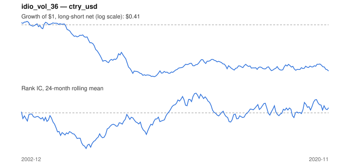

# Signal card: `idio_vol_36`

Negative 36-month residual volatility vs the universe average. Universe: `ctry_usd`, 2002-12 to 2020-11 (216 months), net of 10 bp per unit of turnover.

Verdict: **Not promoted** — passes 1 of 6 gates; fails ic_tstat, dsr, pbo, regimes, marginal.

## Why it should work

No rationale recorded.

Reference: Ang, Hodrick, Xing & Zhang (2006), the cross-section of volatility

## Data and timing

- Uses returns through the end of month t; the forecast is month t+1's return.
- Source: Ken French data library (industry portfolios, factors), latest vintage.
- Parameters: `{'window': 36}`

## Results

| Metric | Value |
|---|---|
| Mean rank IC | -0.031 |
| IC t-stat (Newey-West) | -1.20 |
| IC information ratio (annual) | -0.31 |
| IC hit rate | 46% |
| Long-short return, annual, net | -4.4% |
| Long-short volatility, annual | 9.8% |
| Sharpe, gross / net | -0.43 / -0.45 |
| Sharpe since 2000, net | -0.45 |
| Probabilistic Sharpe (vs 0) | 0.03 |
| Deflated Sharpe (43 trials) | 0.00 |
| Turnover per month | 0.16 |
| Break-even cost | -223 bp |
| Quintile monotonicity | -1.00 |

IC decay (signal at t vs return k months later): 1m -0.031, 2m -0.032, 3m -0.034, 6m -0.042, 12m -0.038

Annual return by quantile: Q1 +10.7%, Q2 +7.1%, Q3 +6.4%

## Promotion gates (PRD §8.4)

| Gate | Threshold | Value | Result |
|---|---|---|---|
| IC t-stat | ≥ 2 | -1.20 | fail |
| Deflated Sharpe | ≥ 0.95 | 0.00 | fail |
| Family PBO | < 20% | 84% | fail |
| Regimes with IC > 0 | ≥ 3 of 4 | 2 of 4 | fail |
| Ensemble ICIR contribution | > 0 | -0.050 | fail |
| Economic rationale | reference | yes | pass |

IC by market regime: down_calm +0.069, down_volatile -0.010, up_calm -0.071, up_volatile +0.034

## Every configuration tried (`idiosyncratic_vol` family)

PBO across 3 configurations: 84% over 184 common months.

| Configuration | IC | t-stat | Sharpe net | DSR |
|---|---|---|---|---|
| `idio_vol_36` | -0.031 | -1.20 | -0.45 | 0.00 |
| `idio_vol_60` | -0.030 | -0.93 | -0.50 | 0.00 |
| `idio_vol_24` | -0.034 | -1.39 | -0.56 | 0.00 |

## Tearsheet



## Where it breaks

- Worst drawdown: -65%, from Apr 2003 to Sep 2010.
- Worst 12 months: -37%, ending Sep 2007.
- Since 2000 the net Sharpe is -0.45 versus -0.45 over the full sample.

## Reproduce

```bash
uv run atlas ingest sdmx --agency oecd --agency ecb
uv run atlas research gates --universe ctry_usd --exclude-holdout
uv run atlas research signal idio_vol_36 --universe ctry_usd
```

_Generated by `atlas research cards` on 2026-10-21. Do not edit by hand._
