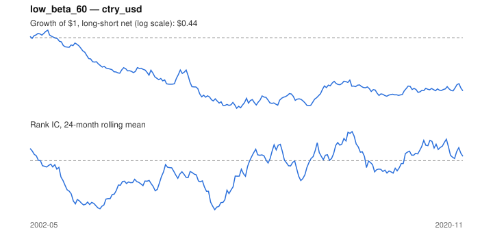

# Signal card: `low_beta_60`

Negative 60-month beta to the universe average (betting against beta). Universe: `ctry_usd`, 2002-05 to 2020-11 (223 months), net of 10 bp per unit of turnover.

Verdict: **Not promoted** — passes 1 of 6 gates; fails ic_tstat, dsr, pbo, regimes, marginal.

## Why it should work

No rationale recorded.

Reference: Frazzini & Pedersen (2014), betting against beta

## Data and timing

- Uses returns through the end of month t; the forecast is month t+1's return.
- Source: Ken French data library (industry portfolios, factors), latest vintage.
- Parameters: `{'window': 60}`

## Results

| Metric | Value |
|---|---|
| Mean rank IC | -0.045 |
| IC t-stat (Newey-West) | -1.48 |
| IC information ratio (annual) | -0.40 |
| IC hit rate | 45% |
| Long-short return, annual, net | -3.7% |
| Long-short volatility, annual | 11.6% |
| Sharpe, gross / net | -0.30 / -0.32 |
| Sharpe since 2000, net | -0.32 |
| Probabilistic Sharpe (vs 0) | 0.09 |
| Deflated Sharpe (43 trials) | 0.00 |
| Turnover per month | 0.13 |
| Break-even cost | -233 bp |
| Quintile monotonicity | -1.00 |

IC decay (signal at t vs return k months later): 1m -0.045, 2m -0.049, 3m -0.047, 6m -0.049, 12m -0.048

Annual return by quantile: Q1 +9.1%, Q2 +6.5%, Q3 +5.5%

## Promotion gates (PRD §8.4)

| Gate | Threshold | Value | Result |
|---|---|---|---|
| IC t-stat | ≥ 2 | -1.48 | fail |
| Deflated Sharpe | ≥ 0.95 | 0.00 | fail |
| Family PBO | < 20% | 55% | fail |
| Regimes with IC > 0 | ≥ 3 of 4 | 0 of 4 | fail |
| Ensemble ICIR contribution | > 0 | -0.036 | fail |
| Economic rationale | reference | yes | pass |

IC by market regime: down_calm -0.149, down_volatile -0.022, up_calm -0.044, up_volatile -0.050

## Every configuration tried (`low_beta` family)

PBO across 2 configurations: 55% over 223 common months.

| Configuration | IC | t-stat | Sharpe net | DSR |
|---|---|---|---|---|
| `low_beta_36` | -0.045 | -1.46 | -0.27 | 0.00 |
| `low_beta_60` | -0.045 | -1.48 | -0.32 | 0.00 |

## Tearsheet



## Where it breaks

- Worst drawdown: -70%, from Feb 2003 to Mar 2011.
- Worst 12 months: -34%, ending Jan 2010.
- Since 2000 the net Sharpe is -0.32 versus -0.32 over the full sample.

## Reproduce

```bash
uv run atlas ingest sdmx --agency oecd --agency ecb
uv run atlas research gates --universe ctry_usd --exclude-holdout
uv run atlas research signal low_beta_60 --universe ctry_usd
```

_Generated by `atlas research cards` on 2026-10-21. Do not edit by hand._
