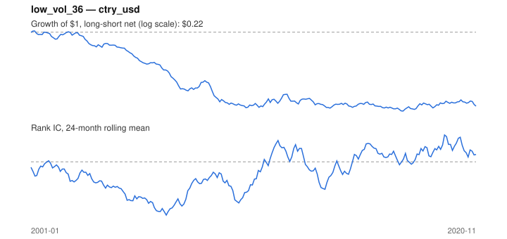

# Signal card: `low_vol_36`

Negative trailing 36-month volatility. Universe: `ctry_usd`, 2001-01 to 2020-11 (239 months), net of 10 bp per unit of turnover.

Verdict: **Not promoted** — passes 1 of 6 gates; fails ic_tstat, dsr, pbo, regimes, marginal.

## Why it should work

Leverage-constrained investors bid up high-beta, high-volatility assets, leaving low-volatility assets with higher risk-adjusted returns.

Reference: Ang, Hodrick, Xing & Zhang (2006); Frazzini & Pedersen (2014)

## Data and timing

- Uses returns through the end of month t; the forecast is month t+1's return.
- Source: Ken French data library (industry portfolios, factors), latest vintage.
- Parameters: `{'window': 36}`

## Results

| Metric | Value |
|---|---|
| Mean rank IC | -0.056 |
| IC t-stat (Newey-West) | -1.90 |
| IC information ratio (annual) | -0.50 |
| IC hit rate | 42% |
| Long-short return, annual, net | -7.1% |
| Long-short volatility, annual | 11.2% |
| Sharpe, gross / net | -0.61 / -0.63 |
| Sharpe since 2000, net | -0.63 |
| Probabilistic Sharpe (vs 0) | 0.00 |
| Deflated Sharpe (43 trials) | 0.00 |
| Turnover per month | 0.21 |
| Break-even cost | -270 bp |
| Quintile monotonicity | -1.00 |

IC decay (signal at t vs return k months later): 1m -0.056, 2m -0.057, 3m -0.060, 6m -0.062, 12m -0.051

Annual return by quantile: Q1 +10.1%, Q2 +5.2%, Q3 +3.3%

## Promotion gates (PRD §8.4)

| Gate | Threshold | Value | Result |
|---|---|---|---|
| IC t-stat | ≥ 2 | -1.90 | fail |
| Deflated Sharpe | ≥ 0.95 | 0.00 | fail |
| Family PBO | < 20% | 98% | fail |
| Regimes with IC > 0 | ≥ 3 of 4 | 1 of 4 | fail |
| Ensemble ICIR contribution | > 0 | -0.015 | fail |
| Economic rationale | reference | yes | pass |

IC by market regime: down_calm +0.058, down_volatile -0.047, up_calm -0.080, up_volatile -0.026

## Every configuration tried (`low_volatility` family)

PBO across 3 configurations: 98% over 223 common months.

| Configuration | IC | t-stat | Sharpe net | DSR |
|---|---|---|---|---|
| `low_vol_24` | -0.055 | -1.86 | -0.59 | 0.00 |
| `low_vol_60` | -0.055 | -1.85 | -0.62 | 0.00 |
| `low_vol_36` | -0.056 | -1.90 | -0.63 | 0.00 |

## Tearsheet



## Where it breaks

- Worst drawdown: -81%, from Mar 2001 to Aug 2017.
- Worst 12 months: -40%, ending Sep 2007.
- Since 2000 the net Sharpe is -0.63 versus -0.63 over the full sample.

## Reproduce

```bash
uv run atlas ingest sdmx --agency oecd --agency ecb
uv run atlas research gates --universe ctry_usd --exclude-holdout
uv run atlas research signal low_vol_36 --universe ctry_usd
```

_Generated by `atlas research cards` on 2026-10-21. Do not edit by hand._
