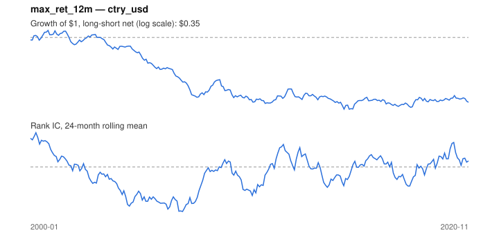

# Signal card: `max_ret_12m`

Negative maximum monthly return over 12 months (avoid lotteries). Universe: `ctry_usd`, 2000-01 to 2020-11 (251 months), net of 10 bp per unit of turnover.

Verdict: **Not promoted** — passes 2 of 6 gates; fails ic_tstat, dsr, regimes, marginal.

## Why it should work

No rationale recorded.

Reference: Bali, Cakici & Whitelaw (2011), maxing out

## Data and timing

- Uses returns through the end of month t; the forecast is month t+1's return.
- Source: Ken French data library (industry portfolios, factors), latest vintage.
- Parameters: `{'months': 12}`

## Results

| Metric | Value |
|---|---|
| Mean rank IC | -0.029 |
| IC t-stat (Newey-West) | -1.18 |
| IC information ratio (annual) | -0.28 |
| IC hit rate | 47% |
| Long-short return, annual, net | -4.4% |
| Long-short volatility, annual | 10.8% |
| Sharpe, gross / net | -0.36 / -0.41 |
| Sharpe since 2000, net | -0.41 |
| Probabilistic Sharpe (vs 0) | 0.03 |
| Deflated Sharpe (43 trials) | 0.00 |
| Turnover per month | 0.40 |
| Break-even cost | -81 bp |
| Quintile monotonicity | -0.50 |

IC decay (signal at t vs return k months later): 1m -0.029, 2m -0.023, 3m -0.024, 6m -0.045, 12m -0.041

Annual return by quantile: Q1 +8.1%, Q2 +3.5%, Q3 +4.2%

## Promotion gates (PRD §8.4)

| Gate | Threshold | Value | Result |
|---|---|---|---|
| IC t-stat | ≥ 2 | -1.18 | fail |
| Deflated Sharpe | ≥ 0.95 | 0.00 | fail |
| Family PBO | < 20% | 1% | pass |
| Regimes with IC > 0 | ≥ 3 of 4 | 2 of 4 | fail |
| Ensemble ICIR contribution | > 0 | -0.027 | fail |
| Economic rationale | reference | yes | pass |

IC by market regime: down_calm +0.056, down_volatile +0.026, up_calm -0.064, up_volatile -0.019

## Every configuration tried (`lottery` family)

PBO across 2 configurations: 1% over 251 common months.

| Configuration | IC | t-stat | Sharpe net | DSR |
|---|---|---|---|---|
| `max_ret_12m` | -0.029 | -1.18 | -0.41 | 0.00 |
| `max_ret_6m` | -0.048 | -1.96 | -0.64 | 0.00 |

## Tearsheet



## Where it breaks

- Worst drawdown: -72%, from Nov 2000 to Mar 2015.
- Worst 12 months: -34%, ending Oct 2007.
- Since 2000 the net Sharpe is -0.41 versus -0.41 over the full sample.

## Reproduce

```bash
uv run atlas ingest sdmx --agency oecd --agency ecb
uv run atlas research gates --universe ctry_usd --exclude-holdout
uv run atlas research signal max_ret_12m --universe ctry_usd
```

_Generated by `atlas research cards` on 2026-10-21. Do not edit by hand._
