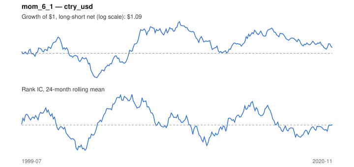

# Signal card: `mom_6_1`

6-month momentum skipping the last 1 month(s). Universe: `ctry_usd`, 1999-07 to 2020-11 (257 months), net of 10 bp per unit of turnover.

Verdict: **Not promoted** — passes 2 of 6 gates; fails ic_tstat, dsr, pbo, regimes.

## Why it should work

Investors under-react to industry news, so prices drift in the direction of recent performance; Moskowitz & Grinblatt find industry momentum explains much of stock-level momentum.

Reference: Jegadeesh & Titman (1993); Moskowitz & Grinblatt (1999), industry momentum

## Data and timing

- Uses returns through the end of month t; the forecast is month t+1's return.
- Source: Ken French data library (industry portfolios, factors), latest vintage.
- Parameters: `{'lookback': 6, 'skip': 1}`

## Results

| Metric | Value |
|---|---|
| Mean rank IC | 0.024 |
| IC t-stat (Newey-West) | 0.97 |
| IC information ratio (annual) | 0.22 |
| IC hit rate | 50% |
| Long-short return, annual, net | 1.1% |
| Long-short volatility, annual | 11.4% |
| Sharpe, gross / net | 0.21 / 0.09 |
| Sharpe since 2000, net | 0.10 |
| Probabilistic Sharpe (vs 0) | 0.67 |
| Deflated Sharpe (43 trials) | 0.00 |
| Turnover per month | 1.13 |
| Break-even cost | 18 bp |
| Quintile monotonicity | 1.00 |

IC decay (signal at t vs return k months later): 1m +0.024, 2m +0.015, 3m +0.029, 6m +0.012, 12m -0.042

Annual return by quantile: Q1 +4.8%, Q2 +5.5%, Q3 +7.2%

## Promotion gates (PRD §8.4)

| Gate | Threshold | Value | Result |
|---|---|---|---|
| IC t-stat | ≥ 2 | 0.97 | fail |
| Deflated Sharpe | ≥ 0.95 | 0.00 | fail |
| Family PBO | < 20% | 91% | fail |
| Regimes with IC > 0 | ≥ 3 of 4 | 2 of 4 | fail |
| Ensemble ICIR contribution | > 0 | +0.063 | pass |
| Economic rationale | reference | yes | pass |

IC by market regime: down_calm -0.073, down_volatile -0.038, up_calm +0.065, up_volatile +0.014

## Every configuration tried (`momentum` family)

PBO across 5 configurations: 91% over 245 common months.

| Configuration | IC | t-stat | Sharpe net | DSR |
|---|---|---|---|---|
| `mom_6_1` | 0.024 | 0.97 | 0.09 | 0.00 |
| `mom_12_1` | 0.026 | 0.96 | 0.05 | 0.00 |
| `mom_9_1` | 0.014 | 0.55 | 0.04 | 0.00 |
| `mom_18_1` | 0.010 | 0.36 | 0.03 | 0.00 |
| `mom_3_1` | -0.014 | -0.58 | -0.15 | 0.00 |

## Tearsheet



## Where it breaks

- Worst drawdown: -46%, from Jan 2002 to Sep 2004.
- Worst 12 months: -27%, ending Jan 2003.
- Since 2000 the net Sharpe is 0.10 versus 0.09 over the full sample.

## Reproduce

```bash
uv run atlas ingest sdmx --agency oecd --agency ecb
uv run atlas research gates --universe ctry_usd --exclude-holdout
uv run atlas research signal mom_6_1 --universe ctry_usd
```

_Generated by `atlas research cards` on 2026-10-21. Do not edit by hand._
