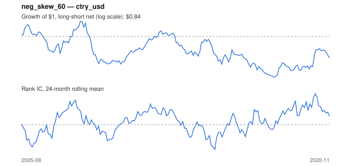

# Signal card: `neg_skew_60`

Negative 60-month return skewness. Universe: `ctry_usd`, 2005-08 to 2020-11 (184 months), net of 10 bp per unit of turnover.

Verdict: **Not promoted** — passes 3 of 6 gates; fails ic_tstat, dsr, pbo.

## Why it should work

No rationale recorded.

Reference: Harvey & Siddique (2000); Amaya et al. (2015) on realized skewness

## Data and timing

- Uses returns through the end of month t; the forecast is month t+1's return.
- Source: Ken French data library (industry portfolios, factors), latest vintage.
- Parameters: `{'window': 60}`

## Results

| Metric | Value |
|---|---|
| Mean rank IC | 0.016 |
| IC t-stat (Newey-West) | 0.67 |
| IC information ratio (annual) | 0.17 |
| IC hit rate | 52% |
| Long-short return, annual, net | -0.7% |
| Long-short volatility, annual | 9.6% |
| Sharpe, gross / net | -0.03 / -0.07 |
| Sharpe since 2000, net | -0.07 |
| Probabilistic Sharpe (vs 0) | 0.39 |
| Deflated Sharpe (43 trials) | 0.00 |
| Turnover per month | 0.33 |
| Break-even cost | -8 bp |
| Quintile monotonicity | -0.50 |

IC decay (signal at t vs return k months later): 1m +0.016, 2m +0.014, 3m -0.001, 6m +0.000, 12m +0.031

Annual return by quantile: Q1 +6.8%, Q2 +3.2%, Q3 +6.5%

## Promotion gates (PRD §8.4)

| Gate | Threshold | Value | Result |
|---|---|---|---|
| IC t-stat | ≥ 2 | 0.67 | fail |
| Deflated Sharpe | ≥ 0.95 | 0.00 | fail |
| Family PBO | < 20% | 56% | fail |
| Regimes with IC > 0 | ≥ 3 of 4 | 3 of 4 | pass |
| Ensemble ICIR contribution | > 0 | +0.020 | pass |
| Economic rationale | reference | yes | pass |

IC by market regime: down_calm +0.179, down_volatile +0.005, up_calm -0.017, up_volatile +0.065

## Every configuration tried (`skewness` family)

PBO across 2 configurations: 56% over 184 common months.

| Configuration | IC | t-stat | Sharpe net | DSR |
|---|---|---|---|---|
| `neg_skew_60` | 0.016 | 0.67 | -0.07 | 0.00 |
| `neg_skew_36` | 0.007 | 0.31 | -0.14 | 0.00 |

## Tearsheet



## Where it breaks

- Worst drawdown: -37%, from Jul 2008 to Feb 2018.
- Worst 12 months: -28%, ending Oct 2009.
- Since 2000 the net Sharpe is -0.07 versus -0.07 over the full sample.

## Reproduce

```bash
uv run atlas ingest sdmx --agency oecd --agency ecb
uv run atlas research gates --universe ctry_usd --exclude-holdout
uv run atlas research signal neg_skew_60 --universe ctry_usd
```

_Generated by `atlas research cards` on 2026-10-21. Do not edit by hand._
