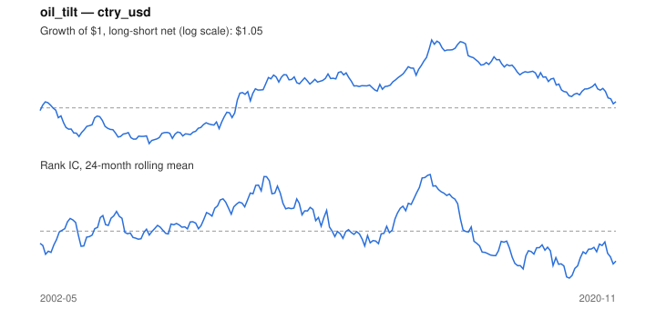

# Signal card: `oil_tilt`

Sensitivity to oil (60-month beta) times its 3-month move. Universe: `ctry_usd`, 2002-05 to 2020-11 (223 months), net of 10 bp per unit of turnover.

Verdict: **Not promoted** — passes 1 of 6 gates; fails ic_tstat, dsr, pbo, regimes, marginal.

## Why it should work

No rationale recorded.

Reference: PRD §6.4 macro-to-sector sensitivity; Moskowitz, Ooi & Pedersen (2012) on trend persistence

## Data and timing

- Uses returns through the end of month t; the forecast is month t+1's return.
- Source: Ken French data library (industry portfolios, factors), latest vintage.
- Parameters: `{'window': 60, 'trend': 3}`

## Results

| Metric | Value |
|---|---|
| Mean rank IC | 0.009 |
| IC t-stat (Newey-West) | 0.37 |
| IC information ratio (annual) | 0.09 |
| IC hit rate | 53% |
| Long-short return, annual, net | 0.8% |
| Long-short volatility, annual | 10.4% |
| Sharpe, gross / net | 0.21 / 0.08 |
| Sharpe since 2000, net | 0.08 |
| Probabilistic Sharpe (vs 0) | 0.63 |
| Deflated Sharpe (43 trials) | 0.00 |
| Turnover per month | 1.12 |
| Break-even cost | 16 bp |
| Quintile monotonicity | 0.50 |

IC decay (signal at t vs return k months later): 1m +0.009, 2m +0.023, 3m -0.027, 6m +0.032, 12m -0.015

Annual return by quantile: Q1 +6.7%, Q2 +6.1%, Q3 +8.9%

## Promotion gates (PRD §8.4)

| Gate | Threshold | Value | Result |
|---|---|---|---|
| IC t-stat | ≥ 2 | 0.37 | fail |
| Deflated Sharpe | ≥ 0.95 | 0.00 | fail |
| Family PBO | < 20% | 81% | fail |
| Regimes with IC > 0 | ≥ 3 of 4 | 2 of 4 | fail |
| Ensemble ICIR contribution | > 0 | -0.009 | fail |
| Economic rationale | reference | yes | pass |

IC by market regime: down_calm +0.056, down_volatile -0.005, up_calm +0.035, up_volatile -0.044

## Every configuration tried (`oil_tilt` family)

PBO across 4 configurations: 81% over 223 common months.

| Configuration | IC | t-stat | Sharpe net | DSR |
|---|---|---|---|---|
| `oil_tilt_36_1` | 0.013 | 0.54 | 0.20 | 0.01 |
| `oil_tilt` | 0.009 | 0.37 | 0.08 | 0.00 |
| `oil_tilt_60_1` | 0.003 | 0.13 | -0.02 | 0.00 |
| `oil_tilt_36_3` | 0.006 | 0.24 | -0.04 | 0.00 |

## Tearsheet



## Where it breaks

- Worst drawdown: -42%, from Dec 2014 to Oct 2020.
- Worst 12 months: -25%, ending Aug 2003.
- Since 2000 the net Sharpe is 0.08 versus 0.08 over the full sample.

## Reproduce

```bash
uv run atlas ingest sdmx --agency oecd --agency ecb
uv run atlas research gates --universe ctry_usd --exclude-holdout
uv run atlas research signal oil_tilt --universe ctry_usd
```

_Generated by `atlas research cards` on 2026-10-21. Do not edit by hand._
