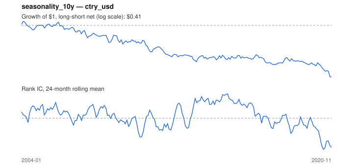

# Signal card: `seasonality_10y`

Average return in the coming calendar month over the past 10 years. Universe: `ctry_usd`, 2004-01 to 2020-11 (203 months), net of 10 bp per unit of turnover.

Verdict: **Not promoted** — passes 2 of 6 gates; fails ic_tstat, dsr, pbo, regimes.

## Why it should work

No rationale recorded.

Reference: Heston & Sadka (2008), seasonality in the cross-section of returns

## Data and timing

- Uses returns through the end of month t; the forecast is month t+1's return.
- Source: Ken French data library (industry portfolios, factors), latest vintage.
- Parameters: `{'years': 10}`

## Results

| Metric | Value |
|---|---|
| Mean rank IC | -0.002 |
| IC t-stat (Newey-West) | -0.07 |
| IC information ratio (annual) | -0.02 |
| IC hit rate | 50% |
| Long-short return, annual, net | -4.7% |
| Long-short volatility, annual | 9.9% |
| Sharpe, gross / net | -0.18 / -0.48 |
| Sharpe since 2000, net | -0.48 |
| Probabilistic Sharpe (vs 0) | 0.02 |
| Deflated Sharpe (43 trials) | 0.00 |
| Turnover per month | 2.47 |
| Break-even cost | -6 bp |
| Quintile monotonicity | -0.50 |

IC decay (signal at t vs return k months later): 1m -0.002, 2m -0.041, 3m -0.028, 6m -0.007, 12m +0.022

Annual return by quantile: Q1 +8.9%, Q2 +4.4%, Q3 +7.1%

## Promotion gates (PRD §8.4)

| Gate | Threshold | Value | Result |
|---|---|---|---|
| IC t-stat | ≥ 2 | -0.07 | fail |
| Deflated Sharpe | ≥ 0.95 | 0.00 | fail |
| Family PBO | < 20% | 88% | fail |
| Regimes with IC > 0 | ≥ 3 of 4 | 2 of 4 | fail |
| Ensemble ICIR contribution | > 0 | +0.053 | pass |
| Economic rationale | reference | yes | pass |

IC by market regime: down_calm +0.089, down_volatile -0.027, up_calm +0.030, up_volatile -0.079

## Every configuration tried (`seasonality` family)

PBO across 3 configurations: 88% over 143 common months.

| Configuration | IC | t-stat | Sharpe net | DSR |
|---|---|---|---|---|
| `seasonality_5y` | -0.000 | -0.01 | -0.39 | 0.00 |
| `seasonality_10y` | -0.002 | -0.07 | -0.48 | 0.00 |
| `seasonality_20y` | -0.010 | -0.37 | -0.59 | 0.00 |

## Tearsheet



## Where it breaks

- Worst drawdown: -62%, from Feb 2004 to Nov 2020.
- Worst 12 months: -21%, ending Oct 2020.
- Since 2000 the net Sharpe is -0.48 versus -0.48 over the full sample.

## Reproduce

```bash
uv run atlas ingest sdmx --agency oecd --agency ecb
uv run atlas research gates --universe ctry_usd --exclude-holdout
uv run atlas research signal seasonality_10y --universe ctry_usd
```

_Generated by `atlas research cards` on 2026-10-21. Do not edit by hand._
