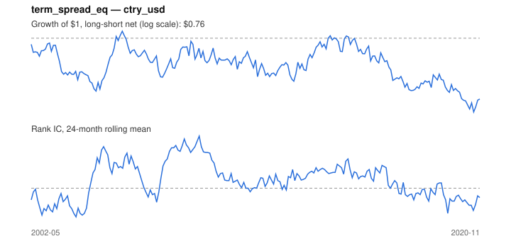

# Signal card: `term_spread_eq`

Local 10-year yield minus the 3-month rate (a steep curve signals growth). Universe: `ctry_usd`, 2002-05 to 2020-11 (222 months), net of 10 bp per unit of turnover.

Verdict: **Not promoted** — passes 3 of 6 gates; fails ic_tstat, dsr, pbo.

## Why it should work

No rationale recorded.

Reference: Estrella & Mishkin (1998); term spread and future growth

## Data and timing

- Uses returns through the end of month t; the forecast is month t+1's return.
- Source: Ken French data library (industry portfolios, factors), latest vintage.
- Parameters: `{'spread': 1}`

## Results

| Metric | Value |
|---|---|
| Mean rank IC | 0.033 |
| IC t-stat (Newey-West) | 1.11 |
| IC information ratio (annual) | 0.24 |
| IC hit rate | 54% |
| Long-short return, annual, net | -1.1% |
| Long-short volatility, annual | 8.7% |
| Sharpe, gross / net | -0.07 / -0.12 |
| Sharpe since 2000, net | -0.12 |
| Probabilistic Sharpe (vs 0) | 0.30 |
| Deflated Sharpe (43 trials) | 0.00 |
| Turnover per month | 0.37 |
| Break-even cost | -14 bp |
| Quintile monotonicity | -0.50 |

IC decay (signal at t vs return k months later): 1m +0.033, 2m +0.028, 3m +0.042, 6m +0.038, 12m +0.013

Annual return by quantile: Q1 +6.6%, Q2 +3.6%, Q3 +6.0%

## Promotion gates (PRD §8.4)

| Gate | Threshold | Value | Result |
|---|---|---|---|
| IC t-stat | ≥ 2 | 1.11 | fail |
| Deflated Sharpe | ≥ 0.95 | 0.00 | fail |
| Family PBO | < 20% | n/a | fail |
| Regimes with IC > 0 | ≥ 3 of 4 | 4 of 4 | pass |
| Ensemble ICIR contribution | > 0 | +0.060 | pass |
| Economic rationale | reference | yes | pass |

IC by market regime: down_calm +0.118, down_volatile +0.090, up_calm +0.014, up_volatile +0.023

## Every configuration tried (`country_curve` family)

PBO across 1 configurations: n/a over 0 common months.

| Configuration | IC | t-stat | Sharpe net | DSR |
|---|---|---|---|---|
| `term_spread_eq` | 0.033 | 1.11 | -0.12 | 0.00 |

## Tearsheet



## Where it breaks

- Worst drawdown: -30%, from Feb 2006 to Aug 2020.
- Worst 12 months: -14%, ending Apr 2004.
- Since 2000 the net Sharpe is -0.12 versus -0.12 over the full sample.

## Reproduce

```bash
uv run atlas ingest sdmx --agency oecd --agency ecb
uv run atlas research gates --universe ctry_usd --exclude-holdout
uv run atlas research signal term_spread_eq --universe ctry_usd
```

_Generated by `atlas research cards` on 2026-10-21. Do not edit by hand._
