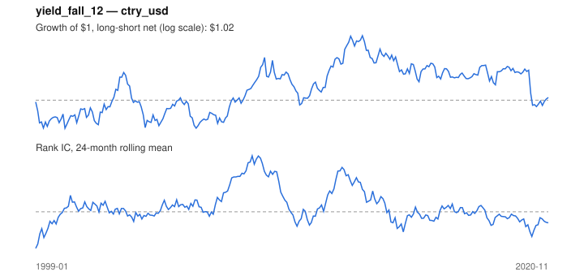

# Signal card: `yield_fall_12`

Fall in the 10-year government yield over 12 months. Universe: `ctry_usd`, 1999-01 to 2020-11 (263 months), net of 10 bp per unit of turnover.

Verdict: **Not promoted** — passes 4 of 6 gates; fails ic_tstat, dsr.

## Why it should work

No rationale recorded.

Reference: Campbell & Ammer (1993); discount-rate channel of equity returns

## Data and timing

- Uses returns through the end of month t; the forecast is month t+1's return.
- Source: Ken French data library (industry portfolios, factors), latest vintage.
- Parameters: `{'months': 12}`

## Results

| Metric | Value |
|---|---|
| Mean rank IC | 0.023 |
| IC t-stat (Newey-West) | 0.95 |
| IC information ratio (annual) | 0.21 |
| IC hit rate | 52% |
| Long-short return, annual, net | 0.6% |
| Long-short volatility, annual | 10.5% |
| Sharpe, gross / net | 0.15 / 0.06 |
| Sharpe since 2000, net | 0.10 |
| Probabilistic Sharpe (vs 0) | 0.61 |
| Deflated Sharpe (43 trials) | 0.00 |
| Turnover per month | 0.78 |
| Break-even cost | 17 bp |
| Quintile monotonicity | 1.00 |

IC decay (signal at t vs return k months later): 1m +0.023, 2m +0.023, 3m +0.046, 6m +0.038, 12m +0.018

Annual return by quantile: Q1 +4.8%, Q2 +5.0%, Q3 +6.4%

## Promotion gates (PRD §8.4)

| Gate | Threshold | Value | Result |
|---|---|---|---|
| IC t-stat | ≥ 2 | 0.95 | fail |
| Deflated Sharpe | ≥ 0.95 | 0.00 | fail |
| Family PBO | < 20% | 3% | pass |
| Regimes with IC > 0 | ≥ 3 of 4 | 3 of 4 | pass |
| Ensemble ICIR contribution | > 0 | +0.014 | pass |
| Economic rationale | reference | yes | pass |

IC by market regime: down_calm +0.150, down_volatile +0.033, up_calm +0.033, up_volatile -0.014

## Every configuration tried (`rates` family)

PBO across 2 configurations: 3% over 263 common months.

| Configuration | IC | t-stat | Sharpe net | DSR |
|---|---|---|---|---|
| `yield_fall_12` | 0.023 | 0.95 | 0.06 | 0.00 |
| `yield_fall_6` | -0.014 | -0.60 | -0.37 | 0.00 |

## Tearsheet



## Where it breaks

- Worst drawdown: -33%, from Dec 2012 to May 2020.
- Worst 12 months: -25%, ending Sep 2003.
- Since 2000 the net Sharpe is 0.10 versus 0.06 over the full sample.

## Reproduce

```bash
uv run atlas ingest sdmx --agency oecd --agency ecb
uv run atlas research gates --universe ctry_usd --exclude-holdout
uv run atlas research signal yield_fall_12 --universe ctry_usd
```

_Generated by `atlas research cards` on 2026-10-21. Do not edit by hand._
