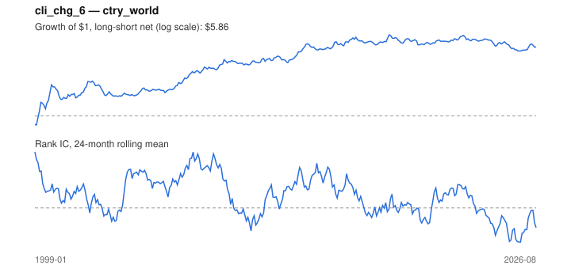

# Signal card: `cli_chg_6`

6-month change in the OECD leading indicator (improving growth). Universe: `ctry_world`, 1999-01 to 2026-08 (332 months), net of 10 bp per unit of turnover.

Verdict: **Not promoted** — passes 4 of 6 gates; fails ic_tstat, dsr.

## Why it should work

No rationale recorded.

Reference: OECD CLI methodology; Stock & Watson (2003) on leading indicators and asset returns

## Data and timing

- Uses returns through the end of month t; the forecast is month t+1's return.
- Source: Ken French data library (industry portfolios, factors), latest vintage.
- Parameters: `{'months': 6}`

## Results

| Metric | Value |
|---|---|
| Mean rank IC | 0.034 |
| IC t-stat (Newey-West) | 1.96 |
| IC information ratio (annual) | 0.39 |
| IC hit rate | 56% |
| Long-short return, annual, net | 7.8% |
| Long-short volatility, annual | 16.8% |
| Sharpe, gross / net | 0.51 / 0.46 |
| Sharpe since 2000, net | 0.34 |
| Probabilistic Sharpe (vs 0) | 1.00 |
| Deflated Sharpe (43 trials) | 0.09 |
| Turnover per month | 0.70 |
| Break-even cost | 103 bp |
| Quintile monotonicity | 0.90 |

IC decay (signal at t vs return k months later): 1m +0.034, 2m +0.002, 3m -0.019, 6m -0.060, 12m -0.034

Annual return by quantile: Q1 +4.7%, Q2 +7.6%, Q3 +6.3%, Q4 +8.6%, Q5 +13.3%

## Promotion gates (PRD §8.4)

| Gate | Threshold | Value | Result |
|---|---|---|---|
| IC t-stat | ≥ 2 | 1.96 | fail |
| Deflated Sharpe | ≥ 0.95 | 0.09 | fail |
| Family PBO | < 20% | 0% | pass |
| Regimes with IC > 0 | ≥ 3 of 4 | 4 of 4 | pass |
| Ensemble ICIR contribution | > 0 | +0.048 | pass |
| Economic rationale | reference | yes | pass |

IC by market regime: down_calm +0.076, down_volatile +0.000, up_calm +0.056, up_volatile +0.021

## Every configuration tried (`leading_indicator` family)

PBO across 4 configurations: 0% over 332 common months.

| Configuration | IC | t-stat | Sharpe net | DSR |
|---|---|---|---|---|
| `cli_chg_3` | 0.074 | 4.22 | 0.67 | 0.73 |
| `cli_chg_6` | 0.034 | 1.96 | 0.46 | 0.19 |
| `cli_chg_12` | -0.015 | -0.96 | -0.04 | 0.00 |
| `cli_level` | -0.049 | -3.25 | -0.61 | 0.00 |

## Tearsheet



## Where it breaks

- Worst drawdown: -34%, from Jul 2018 to Sep 2025.
- Worst 12 months: -30%, ending Dec 2002.
- Since 2000 the net Sharpe is 0.34 versus 0.46 over the full sample.

## Reproduce

```bash
uv run atlas ingest sdmx --agency oecd --agency ecb
uv run atlas research gates --universe ctry_world --exclude-holdout
uv run atlas research signal cli_chg_6 --universe ctry_world
```

_Generated by `atlas research cards` on 2026-10-26. Do not edit by hand._
