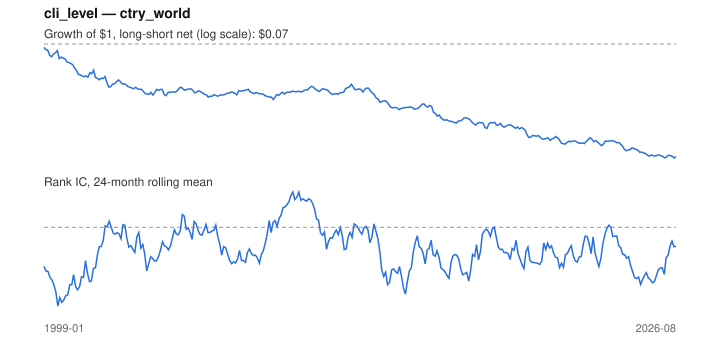

# Signal card: `cli_level`

OECD leading indicator relative to trend (100). Universe: `ctry_world`, 1999-01 to 2026-08 (332 months), net of 10 bp per unit of turnover.

Verdict: **Not promoted** — passes 2 of 6 gates; fails ic_tstat, dsr, regimes, marginal.

## Why it should work

No rationale recorded.

Reference: OECD CLI methodology; Stock & Watson (2003) on leading indicators and asset returns

## Data and timing

- Uses returns through the end of month t; the forecast is month t+1's return.
- Source: Ken French data library (industry portfolios, factors), latest vintage.
- Parameters: `{'level': 1}`

## Results

| Metric | Value |
|---|---|
| Mean rank IC | -0.049 |
| IC t-stat (Newey-West) | -3.25 |
| IC information ratio (annual) | -0.61 |
| IC hit rate | 44% |
| Long-short return, annual, net | -8.4% |
| Long-short volatility, annual | 13.8% |
| Sharpe, gross / net | -0.57 / -0.61 |
| Sharpe since 2000, net | -0.57 |
| Probabilistic Sharpe (vs 0) | 0.00 |
| Deflated Sharpe (43 trials) | 0.00 |
| Turnover per month | 0.41 |
| Break-even cost | -161 bp |
| Quintile monotonicity | -0.90 |

IC decay (signal at t vs return k months later): 1m -0.049, 2m -0.068, 3m -0.077, 6m -0.073, 12m -0.026

Annual return by quantile: Q1 +12.0%, Q2 +6.6%, Q3 +7.8%, Q4 +6.5%, Q5 +4.1%

## Promotion gates (PRD §8.4)

| Gate | Threshold | Value | Result |
|---|---|---|---|
| IC t-stat | ≥ 2 | -3.25 | fail |
| Deflated Sharpe | ≥ 0.95 | 0.00 | fail |
| Family PBO | < 20% | 0% | pass |
| Regimes with IC > 0 | ≥ 3 of 4 | 0 of 4 | fail |
| Ensemble ICIR contribution | > 0 | -0.093 | fail |
| Economic rationale | reference | yes | pass |

IC by market regime: down_calm -0.115, down_volatile -0.037, up_calm -0.039, up_volatile -0.070

## Every configuration tried (`leading_indicator` family)

PBO across 4 configurations: 0% over 332 common months.

| Configuration | IC | t-stat | Sharpe net | DSR |
|---|---|---|---|---|
| `cli_chg_3` | 0.074 | 4.22 | 0.67 | 0.73 |
| `cli_chg_6` | 0.034 | 1.96 | 0.46 | 0.19 |
| `cli_chg_12` | -0.015 | -0.96 | -0.04 | 0.00 |
| `cli_level` | -0.049 | -3.25 | -0.61 | 0.00 |

## Tearsheet



## Where it breaks

- Worst drawdown: -93%, from Jan 1999 to Jul 2026.
- Worst 12 months: -43%, ending Aug 2000.
- Since 2000 the net Sharpe is -0.57 versus -0.61 over the full sample.

## Reproduce

```bash
uv run atlas ingest sdmx --agency oecd --agency ecb
uv run atlas research gates --universe ctry_world --exclude-holdout
uv run atlas research signal cli_level --universe ctry_world
```

_Generated by `atlas research cards` on 2026-10-26. Do not edit by hand._
