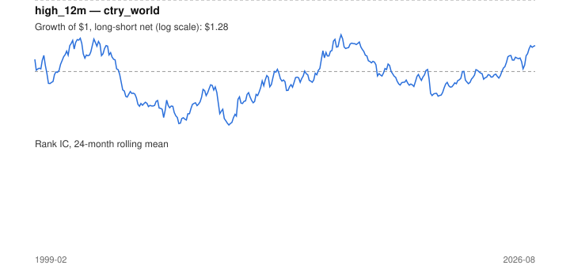

# Signal card: `high_12m`

Distance (log) below the 12-month high of the return index. Universe: `ctry_world`, 1999-02 to 2026-08 (331 months), net of 10 bp per unit of turnover.

Verdict: **Not promoted** — passes 3 of 6 gates; fails dsr, pbo, regimes.

## Why it should work

No rationale recorded.

Reference: George & Hwang (2004), the 52-week high and momentum investing

## Data and timing

- Uses returns through the end of month t; the forecast is month t+1's return.
- Source: Ken French data library (industry portfolios, factors), latest vintage.
- Parameters: `{'months': 12}`

## Results

| Metric | Value |
|---|---|
| Mean rank IC | 0.072 |
| IC t-stat (Newey-West) | 4.87 |
| IC information ratio (annual) | 0.88 |
| IC hit rate | 61% |
| Long-short return, annual, net | 1.9% |
| Long-short volatility, annual | 14.4% |
| Sharpe, gross / net | 0.23 / 0.13 |
| Sharpe since 2000, net | 0.17 |
| Probabilistic Sharpe (vs 0) | 0.76 |
| Deflated Sharpe (43 trials) | 0.00 |
| Turnover per month | 1.14 |
| Break-even cost | 24 bp |
| Quintile monotonicity | 0.90 |

IC decay (signal at t vs return k months later): 1m +nan, 2m +nan, 3m +nan, 6m +nan, 12m +nan

Annual return by quantile: Q1 +5.1%, Q2 +3.3%, Q3 +6.0%, Q4 +8.4%, Q5 +12.4%

## Promotion gates (PRD §8.4)

| Gate | Threshold | Value | Result |
|---|---|---|---|
| IC t-stat | ≥ 2 | 4.87 | pass |
| Deflated Sharpe | ≥ 0.95 | 0.00 | fail |
| Family PBO | < 20% | 74% | fail |
| Regimes with IC > 0 | ≥ 3 of 4 | 1 of 4 | fail |
| Ensemble ICIR contribution | > 0 | +0.180 | pass |
| Economic rationale | reference | yes | pass |

IC by market regime: down_calm -0.077, down_volatile -0.006, up_calm +0.105, up_volatile +nan

## Every configuration tried (`near_high` family)

PBO across 2 configurations: 74% over 331 common months.

| Configuration | IC | t-stat | Sharpe net | DSR |
|---|---|---|---|---|
| `high_24m` | 0.068 | 4.22 | 0.17 | 0.01 |
| `high_12m` | 0.072 | 4.87 | 0.13 | 0.01 |

## Tearsheet



## Where it breaks

- Worst drawdown: -56%, from Aug 2001 to Oct 2009.
- Worst 12 months: -38%, ending Feb 2004.
- Since 2000 the net Sharpe is 0.17 versus 0.13 over the full sample.

## Reproduce

```bash
uv run atlas ingest sdmx --agency oecd --agency ecb
uv run atlas research gates --universe ctry_world --exclude-holdout
uv run atlas research signal high_12m --universe ctry_world
```

_Generated by `atlas research cards` on 2026-10-26. Do not edit by hand._
