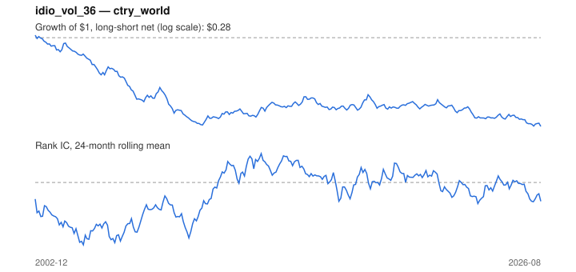

# Signal card: `idio_vol_36`

Negative 36-month residual volatility vs the universe average. Universe: `ctry_world`, 2002-12 to 2026-08 (285 months), net of 10 bp per unit of turnover.

Verdict: **Not promoted** — passes 1 of 6 gates; fails ic_tstat, dsr, pbo, regimes, marginal.

## Why it should work

No rationale recorded.

Reference: Ang, Hodrick, Xing & Zhang (2006), the cross-section of volatility

## Data and timing

- Uses returns through the end of month t; the forecast is month t+1's return.
- Source: Ken French data library (industry portfolios, factors), latest vintage.
- Parameters: `{'window': 36}`

## Results

| Metric | Value |
|---|---|
| Mean rank IC | -0.038 |
| IC t-stat (Newey-West) | -2.06 |
| IC information ratio (annual) | -0.48 |
| IC hit rate | 43% |
| Long-short return, annual, net | -4.8% |
| Long-short volatility, annual | 10.0% |
| Sharpe, gross / net | -0.46 / -0.48 |
| Sharpe since 2000, net | -0.48 |
| Probabilistic Sharpe (vs 0) | 0.01 |
| Deflated Sharpe (43 trials) | 0.00 |
| Turnover per month | 0.21 |
| Break-even cost | -180 bp |
| Quintile monotonicity | -1.00 |

IC decay (signal at t vs return k months later): 1m -0.038, 2m -0.038, 3m -0.039, 6m -0.045, 12m -0.046

Annual return by quantile: Q1 +11.7%, Q2 +10.1%, Q3 +9.0%, Q4 +7.5%, Q5 +7.1%

## Promotion gates (PRD §8.4)

| Gate | Threshold | Value | Result |
|---|---|---|---|
| IC t-stat | ≥ 2 | -2.06 | fail |
| Deflated Sharpe | ≥ 0.95 | 0.00 | fail |
| Family PBO | < 20% | 89% | fail |
| Regimes with IC > 0 | ≥ 3 of 4 | 0 of 4 | fail |
| Ensemble ICIR contribution | > 0 | -0.123 | fail |
| Economic rationale | reference | yes | pass |

IC by market regime: down_calm -0.055, down_volatile -0.049, up_calm -0.053, up_volatile -0.000

## Every configuration tried (`idiosyncratic_vol` family)

PBO across 3 configurations: 89% over 253 common months.

| Configuration | IC | t-stat | Sharpe net | DSR |
|---|---|---|---|---|
| `idio_vol_60` | -0.025 | -1.25 | -0.45 | 0.00 |
| `idio_vol_24` | -0.037 | -2.05 | -0.48 | 0.00 |
| `idio_vol_36` | -0.038 | -2.06 | -0.48 | 0.00 |

## Tearsheet



## Where it breaks

- Worst drawdown: -73%, from Dec 2002 to Aug 2026.
- Worst 12 months: -33%, ending Sep 2007.
- Since 2000 the net Sharpe is -0.48 versus -0.48 over the full sample.

## Reproduce

```bash
uv run atlas ingest sdmx --agency oecd --agency ecb
uv run atlas research gates --universe ctry_world --exclude-holdout
uv run atlas research signal idio_vol_36 --universe ctry_world
```

_Generated by `atlas research cards` on 2026-10-26. Do not edit by hand._
