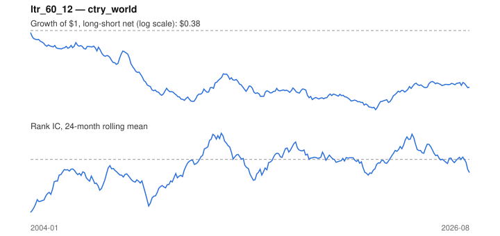

# Signal card: `ltr_60_12`

Negative 60-month return skipping the last 12 months. Universe: `ctry_world`, 2004-01 to 2026-08 (272 months), net of 10 bp per unit of turnover.

Verdict: **Not promoted** — passes 1 of 6 gates; fails ic_tstat, dsr, pbo, regimes, marginal.

## Why it should work

Investors over-extrapolate multi-year performance; long-run losers become too cheap and mean-revert.

Reference: De Bondt & Thaler (1985)

## Data and timing

- Uses returns through the end of month t; the forecast is month t+1's return.
- Source: Ken French data library (industry portfolios, factors), latest vintage.
- Parameters: `{'lookback': 60, 'skip': 12}`

## Results

| Metric | Value |
|---|---|
| Mean rank IC | -0.038 |
| IC t-stat (Newey-West) | -1.81 |
| IC information ratio (annual) | -0.47 |
| IC hit rate | 40% |
| Long-short return, annual, net | -3.7% |
| Long-short volatility, annual | 10.8% |
| Sharpe, gross / net | -0.29 / -0.34 |
| Sharpe since 2000, net | -0.34 |
| Probabilistic Sharpe (vs 0) | 0.06 |
| Deflated Sharpe (43 trials) | 0.00 |
| Turnover per month | 0.45 |
| Break-even cost | -58 bp |
| Quintile monotonicity | -0.90 |

IC decay (signal at t vs return k months later): 1m -0.038, 2m -0.034, 3m -0.032, 6m -0.029, 12m -0.013

Annual return by quantile: Q1 +10.0%, Q2 +7.6%, Q3 +7.2%, Q4 +7.6%, Q5 +6.9%

## Promotion gates (PRD §8.4)

| Gate | Threshold | Value | Result |
|---|---|---|---|
| IC t-stat | ≥ 2 | -1.81 | fail |
| Deflated Sharpe | ≥ 0.95 | 0.00 | fail |
| Family PBO | < 20% | 92% | fail |
| Regimes with IC > 0 | ≥ 3 of 4 | 1 of 4 | fail |
| Ensemble ICIR contribution | > 0 | -0.115 | fail |
| Economic rationale | reference | yes | pass |

IC by market regime: down_calm -0.031, down_volatile +0.018, up_calm -0.051, up_volatile -0.041

## Every configuration tried (`long_term_reversal` family)

PBO across 2 configurations: 92% over 272 common months.

| Configuration | IC | t-stat | Sharpe net | DSR |
|---|---|---|---|---|
| `ltr_36_12` | -0.036 | -1.81 | -0.28 | 0.01 |
| `ltr_60_12` | -0.038 | -1.81 | -0.34 | 0.00 |

## Tearsheet



## Where it breaks

- Worst drawdown: -74%, from Jan 2004 to Oct 2021.
- Worst 12 months: -41%, ending Jan 2010.
- Since 2000 the net Sharpe is -0.34 versus -0.34 over the full sample.

## Reproduce

```bash
uv run atlas ingest sdmx --agency oecd --agency ecb
uv run atlas research gates --universe ctry_world --exclude-holdout
uv run atlas research signal ltr_60_12 --universe ctry_world
```

_Generated by `atlas research cards` on 2026-10-26. Do not edit by hand._
