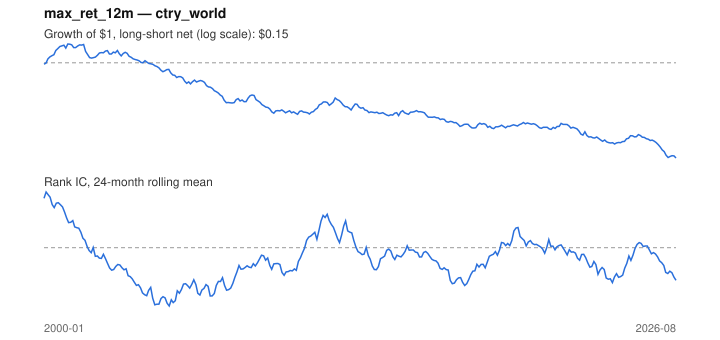

# Signal card: `max_ret_12m`

Negative maximum monthly return over 12 months (avoid lotteries). Universe: `ctry_world`, 2000-01 to 2026-08 (320 months), net of 10 bp per unit of turnover.

Verdict: **Not promoted** — passes 1 of 6 gates; fails ic_tstat, dsr, pbo, regimes, marginal.

## Why it should work

No rationale recorded.

Reference: Bali, Cakici & Whitelaw (2011), maxing out

## Data and timing

- Uses returns through the end of month t; the forecast is month t+1's return.
- Source: Ken French data library (industry portfolios, factors), latest vintage.
- Parameters: `{'months': 12}`

## Results

| Metric | Value |
|---|---|
| Mean rank IC | -0.048 |
| IC t-stat (Newey-West) | -2.66 |
| IC information ratio (annual) | -0.61 |
| IC hit rate | 39% |
| Long-short return, annual, net | -6.5% |
| Long-short volatility, annual | 11.4% |
| Sharpe, gross / net | -0.52 / -0.57 |
| Sharpe since 2000, net | -0.57 |
| Probabilistic Sharpe (vs 0) | 0.00 |
| Deflated Sharpe (43 trials) | 0.00 |
| Turnover per month | 0.49 |
| Break-even cost | -100 bp |
| Quintile monotonicity | -1.00 |

IC decay (signal at t vs return k months later): 1m -0.048, 2m -0.031, 3m -0.027, 6m -0.032, 12m -0.033

Annual return by quantile: Q1 +9.6%, Q2 +7.9%, Q3 +7.3%, Q4 +5.7%, Q5 +3.7%

## Promotion gates (PRD §8.4)

| Gate | Threshold | Value | Result |
|---|---|---|---|
| IC t-stat | ≥ 2 | -2.66 | fail |
| Deflated Sharpe | ≥ 0.95 | 0.00 | fail |
| Family PBO | < 20% | 46% | fail |
| Regimes with IC > 0 | ≥ 3 of 4 | 1 of 4 | fail |
| Ensemble ICIR contribution | > 0 | -0.142 | fail |
| Economic rationale | reference | yes | pass |

IC by market regime: down_calm -0.026, down_volatile -0.047, up_calm -0.086, up_volatile +0.015

## Every configuration tried (`lottery` family)

PBO across 2 configurations: 46% over 320 common months.

| Configuration | IC | t-stat | Sharpe net | DSR |
|---|---|---|---|---|
| `max_ret_12m` | -0.048 | -2.66 | -0.57 | 0.00 |
| `max_ret_6m` | -0.051 | -3.02 | -0.72 | 0.00 |

## Tearsheet



## Where it breaks

- Worst drawdown: -90%, from Jan 2001 to Aug 2026.
- Worst 12 months: -35%, ending Sep 2007.
- Since 2000 the net Sharpe is -0.57 versus -0.57 over the full sample.

## Reproduce

```bash
uv run atlas ingest sdmx --agency oecd --agency ecb
uv run atlas research gates --universe ctry_world --exclude-holdout
uv run atlas research signal max_ret_12m --universe ctry_world
```

_Generated by `atlas research cards` on 2026-10-26. Do not edit by hand._
