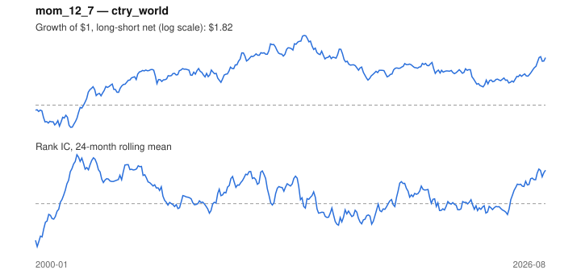

# Signal card: `mom_12_7`

12-month momentum skipping the last 7 month(s). Universe: `ctry_world`, 2000-01 to 2026-08 (320 months), net of 10 bp per unit of turnover.

Verdict: **Not promoted** — passes 4 of 6 gates; fails dsr, pbo.

## Why it should work

Investors under-react to industry news, so prices drift in the direction of recent performance; Moskowitz & Grinblatt find industry momentum explains much of stock-level momentum.

Reference: Jegadeesh & Titman (1993); Moskowitz & Grinblatt (1999), industry momentum

## Data and timing

- Uses returns through the end of month t; the forecast is month t+1's return.
- Source: Ken French data library (industry portfolios, factors), latest vintage.
- Parameters: `{'lookback': 12, 'skip': 7}`

## Results

| Metric | Value |
|---|---|
| Mean rank IC | 0.037 |
| IC t-stat (Newey-West) | 2.11 |
| IC information ratio (annual) | 0.49 |
| IC hit rate | 57% |
| Long-short return, annual, net | 2.9% |
| Long-short volatility, annual | 11.3% |
| Sharpe, gross / net | 0.39 / 0.26 |
| Sharpe since 2000, net | 0.26 |
| Probabilistic Sharpe (vs 0) | 0.90 |
| Deflated Sharpe (43 trials) | 0.01 |
| Turnover per month | 1.28 |
| Break-even cost | 29 bp |
| Quintile monotonicity | 0.70 |

IC decay (signal at t vs return k months later): 1m +0.037, 2m +0.027, 3m +0.013, 6m -0.007, 12m +0.024

Annual return by quantile: Q1 +5.0%, Q2 +6.6%, Q3 +7.6%, Q4 +6.3%, Q5 +9.5%

## Promotion gates (PRD §8.4)

| Gate | Threshold | Value | Result |
|---|---|---|---|
| IC t-stat | ≥ 2 | 2.11 | pass |
| Deflated Sharpe | ≥ 0.95 | 0.01 | fail |
| Family PBO | < 20% | 77% | fail |
| Regimes with IC > 0 | ≥ 3 of 4 | 3 of 4 | pass |
| Ensemble ICIR contribution | > 0 | +0.138 | pass |
| Economic rationale | reference | yes | pass |

IC by market regime: down_calm -0.067, down_volatile +0.013, up_calm +0.050, up_volatile +0.043

## Every configuration tried (`momentum` family)

PBO across 5 configurations: 77% over 314 common months.

| Configuration | IC | t-stat | Sharpe net | DSR |
|---|---|---|---|---|
| `mom_12_1` | 0.038 | 2.13 | 0.06 | 0.35 |
| `mom_9_1` | 0.029 | 1.77 | 0.06 | 0.37 |
| `mom_18_1` | 0.031 | 1.59 | -0.00 | 0.24 |
| `mom_6_1` | 0.022 | 1.52 | -0.03 | 0.30 |
| `mom_3_1` | -0.002 | -0.11 | -0.21 | 0.13 |

## Tearsheet



## Where it breaks

- Worst drawdown: -48%, from Jan 2014 to May 2023.
- Worst 12 months: -25%, ending Feb 2015.
- Since 2000 the net Sharpe is 0.26 versus 0.26 over the full sample.

## Reproduce

```bash
uv run atlas ingest sdmx --agency oecd --agency ecb
uv run atlas research gates --universe ctry_world --exclude-holdout
uv run atlas research signal mom_12_7 --universe ctry_world
```

_Generated by `atlas research cards` on 2026-10-26. Do not edit by hand._
