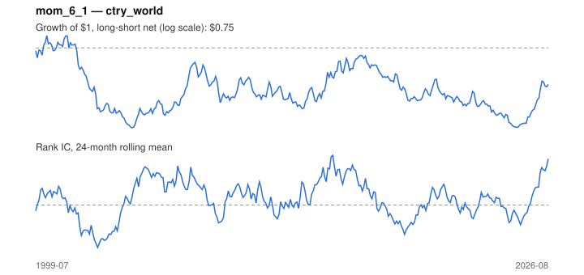

# Signal card: `mom_6_1`

6-month momentum skipping the last 1 month(s). Universe: `ctry_world`, 1999-07 to 2026-08 (326 months), net of 10 bp per unit of turnover.

Verdict: **Not promoted** — passes 2 of 6 gates; fails ic_tstat, dsr, pbo, regimes.

## Why it should work

Investors under-react to industry news, so prices drift in the direction of recent performance; Moskowitz & Grinblatt find industry momentum explains much of stock-level momentum.

Reference: Jegadeesh & Titman (1993); Moskowitz & Grinblatt (1999), industry momentum

## Data and timing

- Uses returns through the end of month t; the forecast is month t+1's return.
- Source: Ken French data library (industry portfolios, factors), latest vintage.
- Parameters: `{'lookback': 6, 'skip': 1}`

## Results

| Metric | Value |
|---|---|
| Mean rank IC | 0.022 |
| IC t-stat (Newey-West) | 1.52 |
| IC information ratio (annual) | 0.28 |
| IC hit rate | 55% |
| Long-short return, annual, net | -0.4% |
| Long-short volatility, annual | 11.8% |
| Sharpe, gross / net | 0.10 / -0.03 |
| Sharpe since 2000, net | -0.04 |
| Probabilistic Sharpe (vs 0) | 0.43 |
| Deflated Sharpe (43 trials) | 0.00 |
| Turnover per month | 1.27 |
| Break-even cost | 8 bp |
| Quintile monotonicity | 0.40 |

IC decay (signal at t vs return k months later): 1m +0.022, 2m +0.017, 3m +0.022, 6m +0.042, 12m -0.007

Annual return by quantile: Q1 +7.5%, Q2 +6.0%, Q3 +6.7%, Q4 +7.3%, Q5 +8.7%

## Promotion gates (PRD §8.4)

| Gate | Threshold | Value | Result |
|---|---|---|---|
| IC t-stat | ≥ 2 | 1.52 | fail |
| Deflated Sharpe | ≥ 0.95 | 0.00 | fail |
| Family PBO | < 20% | 77% | fail |
| Regimes with IC > 0 | ≥ 3 of 4 | 1 of 4 | fail |
| Ensemble ICIR contribution | > 0 | +0.040 | pass |
| Economic rationale | reference | yes | pass |

IC by market regime: down_calm -0.131, down_volatile -0.029, up_calm +0.071, up_volatile -0.009

## Every configuration tried (`momentum` family)

PBO across 5 configurations: 77% over 314 common months.

| Configuration | IC | t-stat | Sharpe net | DSR |
|---|---|---|---|---|
| `mom_12_1` | 0.038 | 2.13 | 0.06 | 0.35 |
| `mom_9_1` | 0.029 | 1.77 | 0.06 | 0.37 |
| `mom_18_1` | 0.031 | 1.59 | -0.00 | 0.24 |
| `mom_6_1` | 0.022 | 1.52 | -0.03 | 0.30 |
| `mom_3_1` | -0.002 | -0.11 | -0.21 | 0.13 |

## Tearsheet



## Where it breaks

- Worst drawdown: -52%, from Feb 2000 to Aug 2004.
- Worst 12 months: -31%, ending Jul 2002.
- Since 2000 the net Sharpe is -0.04 versus -0.03 over the full sample.

## Reproduce

```bash
uv run atlas ingest sdmx --agency oecd --agency ecb
uv run atlas research gates --universe ctry_world --exclude-holdout
uv run atlas research signal mom_6_1 --universe ctry_world
```

_Generated by `atlas research cards` on 2026-10-26. Do not edit by hand._
