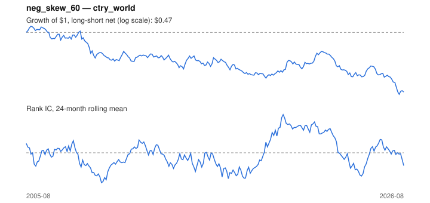

# Signal card: `neg_skew_60`

Negative 60-month return skewness. Universe: `ctry_world`, 2005-08 to 2026-08 (253 months), net of 10 bp per unit of turnover.

Verdict: **Not promoted** — passes 2 of 6 gates; fails ic_tstat, dsr, regimes, marginal.

## Why it should work

No rationale recorded.

Reference: Harvey & Siddique (2000); Amaya et al. (2015) on realized skewness

## Data and timing

- Uses returns through the end of month t; the forecast is month t+1's return.
- Source: Ken French data library (industry portfolios, factors), latest vintage.
- Parameters: `{'window': 60}`

## Results

| Metric | Value |
|---|---|
| Mean rank IC | -0.005 |
| IC t-stat (Newey-West) | -0.33 |
| IC information ratio (annual) | -0.07 |
| IC hit rate | 48% |
| Long-short return, annual, net | -3.1% |
| Long-short volatility, annual | 9.4% |
| Sharpe, gross / net | -0.29 / -0.33 |
| Sharpe since 2000, net | -0.33 |
| Probabilistic Sharpe (vs 0) | 0.07 |
| Deflated Sharpe (43 trials) | 0.00 |
| Turnover per month | 0.33 |
| Break-even cost | -67 bp |
| Quintile monotonicity | -0.60 |

IC decay (signal at t vs return k months later): 1m -0.005, 2m -0.001, 3m -0.009, 6m -0.003, 12m +0.014

Annual return by quantile: Q1 +8.6%, Q2 +6.1%, Q3 +6.3%, Q4 +6.7%, Q5 +5.9%

## Promotion gates (PRD §8.4)

| Gate | Threshold | Value | Result |
|---|---|---|---|
| IC t-stat | ≥ 2 | -0.33 | fail |
| Deflated Sharpe | ≥ 0.95 | 0.00 | fail |
| Family PBO | < 20% | 9% | pass |
| Regimes with IC > 0 | ≥ 3 of 4 | 2 of 4 | fail |
| Ensemble ICIR contribution | > 0 | -0.045 | fail |
| Economic rationale | reference | yes | pass |

IC by market regime: down_calm +0.045, down_volatile -0.044, up_calm -0.027, up_volatile +0.052

## Every configuration tried (`skewness` family)

PBO across 2 configurations: 9% over 253 common months.

| Configuration | IC | t-stat | Sharpe net | DSR |
|---|---|---|---|---|
| `neg_skew_60` | -0.005 | -0.33 | -0.33 | 0.00 |
| `neg_skew_36` | -0.023 | -1.56 | -0.63 | 0.00 |

## Tearsheet



## Where it breaks

- Worst drawdown: -57%, from Nov 2005 to May 2026.
- Worst 12 months: -25%, ending Jun 2009.
- Since 2000 the net Sharpe is -0.33 versus -0.33 over the full sample.

## Reproduce

```bash
uv run atlas ingest sdmx --agency oecd --agency ecb
uv run atlas research gates --universe ctry_world --exclude-holdout
uv run atlas research signal neg_skew_60 --universe ctry_world
```

_Generated by `atlas research cards` on 2026-10-26. Do not edit by hand._
