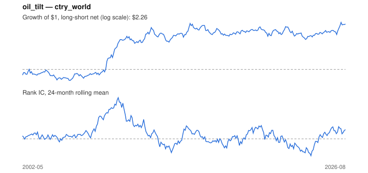

# Signal card: `oil_tilt`

Sensitivity to oil (60-month beta) times its 3-month move. Universe: `ctry_world`, 2002-05 to 2026-08 (292 months), net of 10 bp per unit of turnover.

Verdict: **Not promoted** — passes 3 of 6 gates; fails ic_tstat, dsr, pbo.

## Why it should work

No rationale recorded.

Reference: PRD §6.4 macro-to-sector sensitivity; Moskowitz, Ooi & Pedersen (2012) on trend persistence

## Data and timing

- Uses returns through the end of month t; the forecast is month t+1's return.
- Source: Ken French data library (industry portfolios, factors), latest vintage.
- Parameters: `{'window': 60, 'trend': 3}`

## Results

| Metric | Value |
|---|---|
| Mean rank IC | 0.025 |
| IC t-stat (Newey-West) | 1.56 |
| IC information ratio (annual) | 0.32 |
| IC hit rate | 56% |
| Long-short return, annual, net | 3.9% |
| Long-short volatility, annual | 10.8% |
| Sharpe, gross / net | 0.49 / 0.36 |
| Sharpe since 2000, net | 0.36 |
| Probabilistic Sharpe (vs 0) | 0.97 |
| Deflated Sharpe (43 trials) | 0.05 |
| Turnover per month | 1.15 |
| Break-even cost | 38 bp |
| Quintile monotonicity | 0.90 |

IC decay (signal at t vs return k months later): 1m +0.025, 2m -0.001, 3m -0.022, 6m -0.001, 12m -0.004

Annual return by quantile: Q1 +6.5%, Q2 +7.0%, Q3 +8.9%, Q4 +8.8%, Q5 +11.8%

## Promotion gates (PRD §8.4)

| Gate | Threshold | Value | Result |
|---|---|---|---|
| IC t-stat | ≥ 2 | 1.56 | fail |
| Deflated Sharpe | ≥ 0.95 | 0.05 | fail |
| Family PBO | < 20% | 46% | fail |
| Regimes with IC > 0 | ≥ 3 of 4 | 4 of 4 | pass |
| Ensemble ICIR contribution | > 0 | +0.053 | pass |
| Economic rationale | reference | yes | pass |

IC by market regime: down_calm +0.018, down_volatile +0.031, up_calm +0.027, up_volatile +0.017

## Every configuration tried (`oil_tilt` family)

PBO across 4 configurations: 46% over 292 common months.

| Configuration | IC | t-stat | Sharpe net | DSR |
|---|---|---|---|---|
| `oil_tilt` | 0.025 | 1.56 | 0.36 | 0.05 |
| `oil_tilt_36_1` | 0.032 | 1.87 | 0.19 | 0.01 |
| `oil_tilt_60_1` | 0.022 | 1.26 | 0.18 | 0.01 |
| `oil_tilt_36_3` | 0.010 | 0.56 | 0.03 | 0.00 |

## Tearsheet



## Where it breaks

- Worst drawdown: -25%, from Dec 2014 to Aug 2023.
- Worst 12 months: -18%, ending Mar 2013.
- Since 2000 the net Sharpe is 0.36 versus 0.36 over the full sample.

## Reproduce

```bash
uv run atlas ingest sdmx --agency oecd --agency ecb
uv run atlas research gates --universe ctry_world --exclude-holdout
uv run atlas research signal oil_tilt --universe ctry_world
```

_Generated by `atlas research cards` on 2026-10-26. Do not edit by hand._
