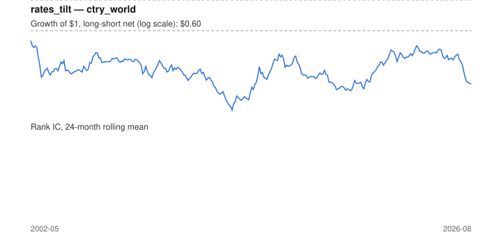

# Signal card: `rates_tilt`

Sensitivity to the 10-year yield (60-month beta) times its 3-month move. Universe: `ctry_world`, 2002-05 to 2026-08 (287 months), net of 10 bp per unit of turnover.

Verdict: **Not promoted** — passes 2 of 6 gates; fails ic_tstat, dsr, pbo, regimes.

## Why it should work

No rationale recorded.

Reference: PRD §6.4 macro-to-sector sensitivity; Moskowitz, Ooi & Pedersen (2012) on trend persistence

## Data and timing

- Uses returns through the end of month t; the forecast is month t+1's return.
- Source: Ken French data library (industry portfolios, factors), latest vintage.
- Parameters: `{'window': 60, 'trend': 3}`

## Results

| Metric | Value |
|---|---|
| Mean rank IC | 0.002 |
| IC t-stat (Newey-West) | 0.10 |
| IC information ratio (annual) | 0.02 |
| IC hit rate | 50% |
| Long-short return, annual, net | -1.5% |
| Long-short volatility, annual | 10.7% |
| Sharpe, gross / net | -0.00 / -0.14 |
| Sharpe since 2000, net | -0.14 |
| Probabilistic Sharpe (vs 0) | 0.24 |
| Deflated Sharpe (43 trials) | 0.00 |
| Turnover per month | 1.24 |
| Break-even cost | -0 bp |
| Quintile monotonicity | -0.10 |

IC decay (signal at t vs return k months later): 1m +nan, 2m +nan, 3m +nan, 6m +nan, 12m +nan

Annual return by quantile: Q1 +9.7%, Q2 +6.4%, Q3 +9.3%, Q4 +7.4%, Q5 +9.6%

## Promotion gates (PRD §8.4)

| Gate | Threshold | Value | Result |
|---|---|---|---|
| IC t-stat | ≥ 2 | 0.10 | fail |
| Deflated Sharpe | ≥ 0.95 | 0.00 | fail |
| Family PBO | < 20% | 92% | fail |
| Regimes with IC > 0 | ≥ 3 of 4 | 2 of 4 | fail |
| Ensemble ICIR contribution | > 0 | +0.001 | pass |
| Economic rationale | reference | yes | pass |

IC by market regime: down_calm +0.015, down_volatile +nan, up_calm +nan, up_volatile +0.031

## Every configuration tried (`rates_tilt` family)

PBO across 4 configurations: 92% over 282 common months.

| Configuration | IC | t-stat | Sharpe net | DSR |
|---|---|---|---|---|
| `rates_tilt_36_1` | 0.008 | 0.59 | 0.04 | 0.00 |
| `rates_tilt_36_3` | -0.008 | -0.47 | -0.13 | 0.00 |
| `rates_tilt` | 0.002 | 0.10 | -0.14 | 0.00 |
| `rates_tilt_60_1` | -0.001 | -0.06 | -0.19 | 0.00 |

## Tearsheet



## Where it breaks

- Worst drawdown: -53%, from May 2002 to Jun 2013.
- Worst 12 months: -33%, ending May 2003.
- Since 2000 the net Sharpe is -0.14 versus -0.14 over the full sample.

## Reproduce

```bash
uv run atlas ingest sdmx --agency oecd --agency ecb
uv run atlas research gates --universe ctry_world --exclude-holdout
uv run atlas research signal rates_tilt --universe ctry_world
```

_Generated by `atlas research cards` on 2026-10-26. Do not edit by hand._
