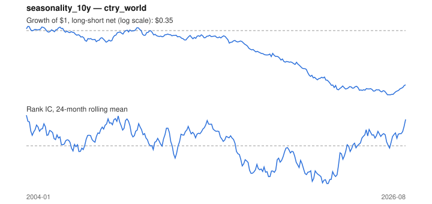

# Signal card: `seasonality_10y`

Average return in the coming calendar month over the past 10 years. Universe: `ctry_world`, 2004-01 to 2026-08 (272 months), net of 10 bp per unit of turnover.

Verdict: **Not promoted** — passes 3 of 6 gates; fails ic_tstat, dsr, pbo.

## Why it should work

No rationale recorded.

Reference: Heston & Sadka (2008), seasonality in the cross-section of returns

## Data and timing

- Uses returns through the end of month t; the forecast is month t+1's return.
- Source: Ken French data library (industry portfolios, factors), latest vintage.
- Parameters: `{'years': 10}`

## Results

| Metric | Value |
|---|---|
| Mean rank IC | 0.011 |
| IC t-stat (Newey-West) | 0.75 |
| IC information ratio (annual) | 0.17 |
| IC hit rate | 53% |
| Long-short return, annual, net | -4.3% |
| Long-short volatility, annual | 8.7% |
| Sharpe, gross / net | -0.10 / -0.49 |
| Sharpe since 2000, net | -0.49 |
| Probabilistic Sharpe (vs 0) | 0.01 |
| Deflated Sharpe (43 trials) | 0.00 |
| Turnover per month | 2.83 |
| Break-even cost | -3 bp |
| Quintile monotonicity | -0.10 |

IC decay (signal at t vs return k months later): 1m +0.011, 2m -0.031, 3m -0.000, 6m -0.012, 12m +0.013

Annual return by quantile: Q1 +9.7%, Q2 +6.5%, Q3 +6.0%, Q4 +8.3%, Q5 +8.8%

## Promotion gates (PRD §8.4)

| Gate | Threshold | Value | Result |
|---|---|---|---|
| IC t-stat | ≥ 2 | 0.75 | fail |
| Deflated Sharpe | ≥ 0.95 | 0.00 | fail |
| Family PBO | < 20% | 66% | fail |
| Regimes with IC > 0 | ≥ 3 of 4 | 3 of 4 | pass |
| Ensemble ICIR contribution | > 0 | +0.045 | pass |
| Economic rationale | reference | yes | pass |

IC by market regime: down_calm +0.077, down_volatile +0.034, up_calm +0.008, up_volatile -0.003

## Every configuration tried (`seasonality` family)

PBO across 3 configurations: 66% over 212 common months.

| Configuration | IC | t-stat | Sharpe net | DSR |
|---|---|---|---|---|
| `seasonality_5y` | 0.009 | 0.64 | -0.31 | 0.00 |
| `seasonality_20y` | 0.014 | 0.97 | -0.35 | 0.00 |
| `seasonality_10y` | 0.011 | 0.75 | -0.49 | 0.00 |

## Tearsheet



## Where it breaks

- Worst drawdown: -74%, from Feb 2004 to Sep 2025.
- Worst 12 months: -26%, ending Feb 2021.
- Since 2000 the net Sharpe is -0.49 versus -0.49 over the full sample.

## Reproduce

```bash
uv run atlas ingest sdmx --agency oecd --agency ecb
uv run atlas research gates --universe ctry_world --exclude-holdout
uv run atlas research signal seasonality_10y --universe ctry_world
```

_Generated by `atlas research cards` on 2026-10-26. Do not edit by hand._
