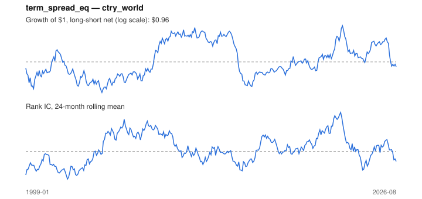

# Signal card: `term_spread_eq`

Local 10-year yield minus the 3-month rate (a steep curve signals growth). Universe: `ctry_world`, 1999-01 to 2026-08 (332 months), net of 10 bp per unit of turnover.

Verdict: **Not promoted** — passes 2 of 6 gates; fails ic_tstat, dsr, pbo, marginal.

## Why it should work

No rationale recorded.

Reference: Estrella & Mishkin (1998); term spread and future growth

## Data and timing

- Uses returns through the end of month t; the forecast is month t+1's return.
- Source: Ken French data library (industry portfolios, factors), latest vintage.
- Parameters: `{'spread': 1}`

## Results

| Metric | Value |
|---|---|
| Mean rank IC | 0.007 |
| IC t-stat (Newey-West) | 0.44 |
| IC information ratio (annual) | 0.09 |
| IC hit rate | 50% |
| Long-short return, annual, net | 0.4% |
| Long-short volatility, annual | 10.5% |
| Sharpe, gross / net | 0.11 / 0.04 |
| Sharpe since 2000, net | 0.08 |
| Probabilistic Sharpe (vs 0) | 0.58 |
| Deflated Sharpe (43 trials) | 0.00 |
| Turnover per month | 0.66 |
| Break-even cost | 15 bp |
| Quintile monotonicity | 0.10 |

IC decay (signal at t vs return k months later): 1m +0.007, 2m +0.007, 3m +0.008, 6m +0.000, 12m -0.017

Annual return by quantile: Q1 +8.6%, Q2 +8.0%, Q3 +7.3%, Q4 +7.7%, Q5 +9.8%

## Promotion gates (PRD §8.4)

| Gate | Threshold | Value | Result |
|---|---|---|---|
| IC t-stat | ≥ 2 | 0.44 | fail |
| Deflated Sharpe | ≥ 0.95 | 0.00 | fail |
| Family PBO | < 20% | n/a | fail |
| Regimes with IC > 0 | ≥ 3 of 4 | 3 of 4 | pass |
| Ensemble ICIR contribution | > 0 | -0.007 | fail |
| Economic rationale | reference | yes | pass |

IC by market regime: down_calm +0.028, down_volatile -0.042, up_calm +0.033, up_volatile +0.001

## Every configuration tried (`country_curve` family)

PBO across 1 configurations: n/a over 0 common months.

| Configuration | IC | t-stat | Sharpe net | DSR |
|---|---|---|---|---|
| `term_spread_eq` | 0.007 | 0.44 | 0.04 | 0.00 |

## Tearsheet



## Where it breaks

- Worst drawdown: -40%, from Aug 2011 to Nov 2015.
- Worst 12 months: -35%, ending May 2015.
- Since 2000 the net Sharpe is 0.08 versus 0.04 over the full sample.

## Reproduce

```bash
uv run atlas ingest sdmx --agency oecd --agency ecb
uv run atlas research gates --universe ctry_world --exclude-holdout
uv run atlas research signal term_spread_eq --universe ctry_world
```

_Generated by `atlas research cards` on 2026-10-26. Do not edit by hand._
