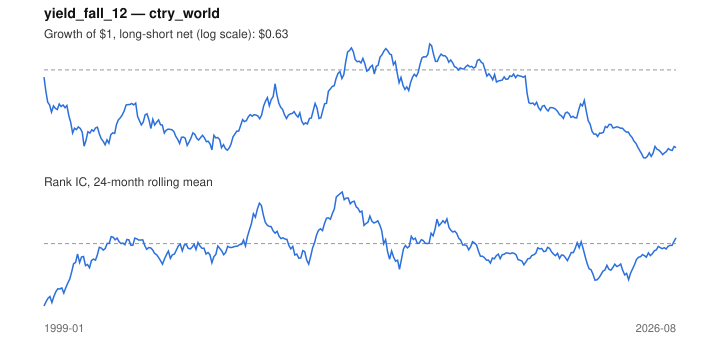

# Signal card: `yield_fall_12`

Fall in the 10-year government yield over 12 months. Universe: `ctry_world`, 1999-01 to 2026-08 (332 months), net of 10 bp per unit of turnover.

Verdict: **Not promoted** — passes 1 of 6 gates; fails ic_tstat, dsr, pbo, regimes, marginal.

## Why it should work

No rationale recorded.

Reference: Campbell & Ammer (1993); discount-rate channel of equity returns

## Data and timing

- Uses returns through the end of month t; the forecast is month t+1's return.
- Source: Ken French data library (industry portfolios, factors), latest vintage.
- Parameters: `{'months': 12}`

## Results

| Metric | Value |
|---|---|
| Mean rank IC | -0.013 |
| IC t-stat (Newey-West) | -0.77 |
| IC information ratio (annual) | -0.17 |
| IC hit rate | 49% |
| Long-short return, annual, net | -1.2% |
| Long-short volatility, annual | 9.8% |
| Sharpe, gross / net | -0.02 / -0.12 |
| Sharpe since 2000, net | -0.04 |
| Probabilistic Sharpe (vs 0) | 0.27 |
| Deflated Sharpe (43 trials) | 0.00 |
| Turnover per month | 0.85 |
| Break-even cost | -1 bp |
| Quintile monotonicity | -0.60 |

IC decay (signal at t vs return k months later): 1m -0.013, 2m -0.010, 3m +0.003, 6m +0.016, 12m +0.012

Annual return by quantile: Q1 +8.1%, Q2 +8.3%, Q3 +6.3%, Q4 +5.1%, Q5 +7.9%

## Promotion gates (PRD §8.4)

| Gate | Threshold | Value | Result |
|---|---|---|---|
| IC t-stat | ≥ 2 | -0.77 | fail |
| Deflated Sharpe | ≥ 0.95 | 0.00 | fail |
| Family PBO | < 20% | 53% | fail |
| Regimes with IC > 0 | ≥ 3 of 4 | 0 of 4 | fail |
| Ensemble ICIR contribution | > 0 | -0.050 | fail |
| Economic rationale | reference | yes | pass |

IC by market regime: down_calm -0.011, down_volatile -0.021, up_calm -0.002, up_volatile -0.024

## Every configuration tried (`rates` family)

PBO across 2 configurations: 53% over 332 common months.

| Configuration | IC | t-stat | Sharpe net | DSR |
|---|---|---|---|---|
| `yield_fall_12` | -0.013 | -0.77 | -0.12 | 0.00 |
| `yield_fall_6` | -0.005 | -0.28 | -0.21 | 0.00 |

## Tearsheet



## Where it breaks

- Worst drawdown: -49%, from Nov 2015 to Apr 2025.
- Worst 12 months: -22%, ending Dec 2014.
- Since 2000 the net Sharpe is -0.04 versus -0.12 over the full sample.

## Reproduce

```bash
uv run atlas ingest sdmx --agency oecd --agency ecb
uv run atlas research gates --universe ctry_world --exclude-holdout
uv run atlas research signal yield_fall_12 --universe ctry_world
```

_Generated by `atlas research cards` on 2026-10-26. Do not edit by hand._
