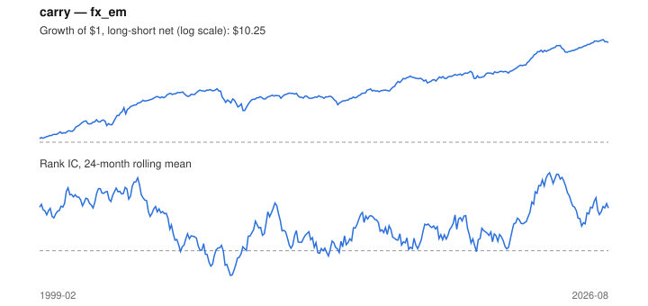

# Signal card: `carry`

Short-rate differential vs the US dollar. Universe: `fx_em`, 1999-02 to 2026-08 (331 months), net of 10 bp per unit of turnover.

Verdict: **Not promoted** — passes 4 of 6 gates; fails dsr, pbo.

## Why it should work

No rationale recorded.

Reference: Lustig, Roussanov & Verdelhan (2011); Koijen, Moskowitz, Pedersen & Vrugt (2018)

## Data and timing

- Uses returns through the end of month t; the forecast is month t+1's return.
- Source: Ken French data library (industry portfolios, factors), latest vintage.
- Parameters: `{'smooth': 1}`

## Results

| Metric | Value |
|---|---|
| Mean rank IC | 0.114 |
| IC t-stat (Newey-West) | 4.86 |
| IC information ratio (annual) | 1.02 |
| IC hit rate | 62% |
| Long-short return, annual, net | 9.2% |
| Long-short volatility, annual | 12.1% |
| Sharpe, gross / net | 0.79 / 0.76 |
| Sharpe since 2000, net | 0.72 |
| Probabilistic Sharpe (vs 0) | 1.00 |
| Deflated Sharpe (12 trials) | 0.81 |
| Turnover per month | 0.27 |
| Break-even cost | 289 bp |
| Quintile monotonicity | 0.70 |

IC decay (signal at t vs return k months later): 1m +0.114, 2m +0.111, 3m +0.106, 6m +0.102, 12m +0.085

Annual return by quantile: Q1 +0.7%, Q2 +2.2%, Q3 -0.9%, Q4 +3.9%, Q5 +10.2%

## Promotion gates (PRD §8.4)

| Gate | Threshold | Value | Result |
|---|---|---|---|
| IC t-stat | ≥ 2 | 4.86 | pass |
| Deflated Sharpe | ≥ 0.95 | 0.81 | fail |
| Family PBO | < 20% | 62% | fail |
| Regimes with IC > 0 | ≥ 3 of 4 | 4 of 4 | pass |
| Ensemble ICIR contribution | > 0 | +0.234 | pass |
| Economic rationale | reference | yes | pass |

IC by market regime: down_calm +0.014, down_volatile +0.239, up_calm +0.074, up_volatile +0.090

## Every configuration tried (`carry` family)

PBO across 3 configurations: 62% over 320 common months.

| Configuration | IC | t-stat | Sharpe net | DSR |
|---|---|---|---|---|
| `carry_avg_3` | 0.113 | 4.67 | 0.84 | 0.88 |
| `carry` | 0.114 | 4.86 | 0.76 | 0.82 |
| `carry_avg_12` | 0.107 | 4.25 | 0.69 | 0.66 |

## Tearsheet



## Where it breaks

- Worst drawdown: -40%, from Sep 2007 to Dec 2008.
- Worst 12 months: -35%, ending Sep 2008.
- Since 2000 the net Sharpe is 0.72 versus 0.76 over the full sample.

## Reproduce

```bash
uv run atlas ingest sdmx --agency ecb --agency oecd
uv run atlas research gates --universe fx_em --exclude-holdout
uv run atlas research signal carry --universe fx_em
```

_Generated by `atlas research cards` on 2026-10-26. Do not edit by hand._
