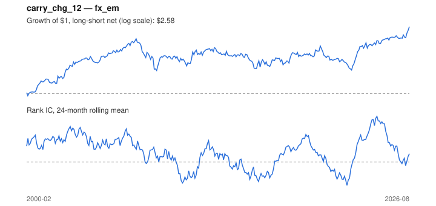

# Signal card: `carry_chg_12`

Change in the rate differential vs the US over 12 months. Universe: `fx_em`, 2000-02 to 2026-08 (319 months), net of 10 bp per unit of turnover.

Verdict: **Not promoted** — passes 3 of 6 gates; fails dsr, regimes, marginal.

## Why it should work

No rationale recorded.

Reference: Bakshi & Panayotov (2013); rising relative rates attract capital

## Data and timing

- Uses returns through the end of month t; the forecast is month t+1's return.
- Source: Ken French data library (industry portfolios, factors), latest vintage.
- Parameters: `{'months': 12}`

## Results

| Metric | Value |
|---|---|
| Mean rank IC | 0.055 |
| IC t-stat (Newey-West) | 2.41 |
| IC information ratio (annual) | 0.50 |
| IC hit rate | 54% |
| Long-short return, annual, net | 4.2% |
| Long-short volatility, annual | 11.3% |
| Sharpe, gross / net | 0.45 / 0.37 |
| Sharpe since 2000, net | 0.37 |
| Probabilistic Sharpe (vs 0) | 0.97 |
| Deflated Sharpe (12 trials) | 0.15 |
| Turnover per month | 0.77 |
| Break-even cost | 55 bp |
| Quintile monotonicity | 0.60 |

IC decay (signal at t vs return k months later): 1m +0.055, 2m +0.039, 3m +0.030, 6m +0.018, 12m +0.024

Annual return by quantile: Q1 +2.3%, Q2 +0.0%, Q3 -0.4%, Q4 +5.1%, Q5 +7.4%

## Promotion gates (PRD §8.4)

| Gate | Threshold | Value | Result |
|---|---|---|---|
| IC t-stat | ≥ 2 | 2.41 | pass |
| Deflated Sharpe | ≥ 0.95 | 0.15 | fail |
| Family PBO | < 20% | 2% | pass |
| Regimes with IC > 0 | ≥ 3 of 4 | 2 of 4 | fail |
| Ensemble ICIR contribution | > 0 | -0.000 | fail |
| Economic rationale | reference | yes | pass |

IC by market regime: down_calm -0.008, down_volatile +0.165, up_calm +0.041, up_volatile -0.007

## Every configuration tried (`carry_change` family)

PBO across 2 configurations: 2% over 319 common months.

| Configuration | IC | t-stat | Sharpe net | DSR |
|---|---|---|---|---|
| `carry_chg_12` | 0.055 | 2.41 | 0.37 | 0.15 |
| `carry_chg_6` | 0.038 | 1.92 | 0.08 | 0.01 |

## Tearsheet



## Where it breaks

- Worst drawdown: -36%, from Sep 2007 to Feb 2009.
- Worst 12 months: -31%, ending Dec 2008.
- Since 2000 the net Sharpe is 0.37 versus 0.37 over the full sample.

## Reproduce

```bash
uv run atlas ingest sdmx --agency ecb --agency oecd
uv run atlas research gates --universe fx_em --exclude-holdout
uv run atlas research signal carry_chg_12 --universe fx_em
```

_Generated by `atlas research cards` on 2026-10-26. Do not edit by hand._
