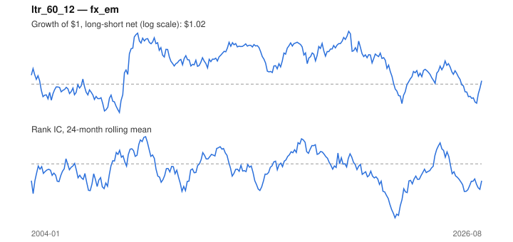

# Signal card: `ltr_60_12`

Negative 60-month return skipping the last 12 months. Universe: `fx_em`, 2004-01 to 2026-08 (272 months), net of 10 bp per unit of turnover.

Verdict: **Not promoted** — passes 1 of 6 gates; fails ic_tstat, dsr, pbo, regimes, marginal.

## Why it should work

Investors over-extrapolate multi-year performance; long-run losers become too cheap and mean-revert.

Reference: De Bondt & Thaler (1985)

## Data and timing

- Uses returns through the end of month t; the forecast is month t+1's return.
- Source: Ken French data library (industry portfolios, factors), latest vintage.
- Parameters: `{'lookback': 60, 'skip': 12}`

## Results

| Metric | Value |
|---|---|
| Mean rank IC | -0.025 |
| IC t-stat (Newey-West) | -0.94 |
| IC information ratio (annual) | -0.20 |
| IC hit rate | 48% |
| Long-short return, annual, net | 0.8% |
| Long-short volatility, annual | 11.7% |
| Sharpe, gross / net | 0.12 / 0.07 |
| Sharpe since 2000, net | 0.07 |
| Probabilistic Sharpe (vs 0) | 0.62 |
| Deflated Sharpe (12 trials) | 0.01 |
| Turnover per month | 0.55 |
| Break-even cost | 22 bp |
| Quintile monotonicity | 0.10 |

IC decay (signal at t vs return k months later): 1m -0.025, 2m -0.022, 3m -0.025, 6m -0.025, 12m +0.002

Annual return by quantile: Q1 +3.2%, Q2 +2.5%, Q3 -0.1%, Q4 +1.8%, Q5 +4.7%

## Promotion gates (PRD §8.4)

| Gate | Threshold | Value | Result |
|---|---|---|---|
| IC t-stat | ≥ 2 | -0.94 | fail |
| Deflated Sharpe | ≥ 0.95 | 0.01 | fail |
| Family PBO | < 20% | 93% | fail |
| Regimes with IC > 0 | ≥ 3 of 4 | 1 of 4 | fail |
| Ensemble ICIR contribution | > 0 | -0.114 | fail |
| Economic rationale | reference | yes | pass |

IC by market regime: down_calm -0.102, down_volatile +0.071, up_calm -0.046, up_volatile -0.028

## Every configuration tried (`long_term_reversal` family)

PBO across 2 configurations: 93% over 272 common months.

| Configuration | IC | t-stat | Sharpe net | DSR |
|---|---|---|---|---|
| `ltr_36_12` | -0.000 | -0.02 | 0.27 | 0.06 |
| `ltr_60_12` | -0.025 | -0.94 | 0.07 | 0.01 |

## Tearsheet



## Where it breaks

- Worst drawdown: -39%, from Dec 2019 to Aug 2022.
- Worst 12 months: -27%, ending Aug 2022.
- Since 2000 the net Sharpe is 0.07 versus 0.07 over the full sample.

## Reproduce

```bash
uv run atlas ingest sdmx --agency ecb --agency oecd
uv run atlas research gates --universe fx_em --exclude-holdout
uv run atlas research signal ltr_60_12 --universe fx_em
```

_Generated by `atlas research cards` on 2026-10-26. Do not edit by hand._
