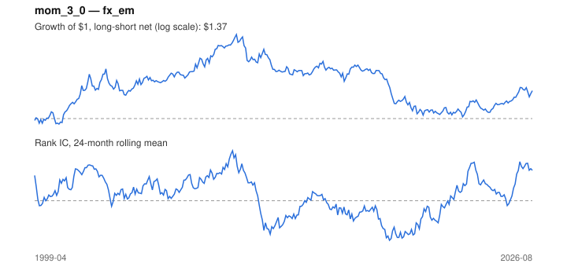

# Signal card: `mom_3_0`

3-month momentum skipping the last 0 month(s). Universe: `fx_em`, 1999-04 to 2026-08 (329 months), net of 10 bp per unit of turnover.

Verdict: **Not promoted** — passes 2 of 6 gates; fails ic_tstat, dsr, pbo, marginal.

## Why it should work

Investors under-react to industry news, so prices drift in the direction of recent performance; Moskowitz & Grinblatt find industry momentum explains much of stock-level momentum.

Reference: Jegadeesh & Titman (1993); Moskowitz & Grinblatt (1999), industry momentum

## Data and timing

- Uses returns through the end of month t; the forecast is month t+1's return.
- Source: Ken French data library (industry portfolios, factors), latest vintage.
- Parameters: `{'lookback': 3, 'skip': 0}`

## Results

| Metric | Value |
|---|---|
| Mean rank IC | 0.032 |
| IC t-stat (Newey-West) | 1.25 |
| IC information ratio (annual) | 0.25 |
| IC hit rate | 51% |
| Long-short return, annual, net | 1.9% |
| Long-short volatility, annual | 12.4% |
| Sharpe, gross / net | 0.35 / 0.16 |
| Sharpe since 2000, net | 0.16 |
| Probabilistic Sharpe (vs 0) | 0.79 |
| Deflated Sharpe (12 trials) | 0.01 |
| Turnover per month | 2.03 |
| Break-even cost | 18 bp |
| Quintile monotonicity | 0.60 |

IC decay (signal at t vs return k months later): 1m +0.032, 2m +0.035, 3m +0.016, 6m +0.069, 12m -0.033

Annual return by quantile: Q1 +2.9%, Q2 +1.0%, Q3 +0.4%, Q4 +3.2%, Q5 +7.3%

## Promotion gates (PRD §8.4)

| Gate | Threshold | Value | Result |
|---|---|---|---|
| IC t-stat | ≥ 2 | 1.25 | fail |
| Deflated Sharpe | ≥ 0.95 | 0.01 | fail |
| Family PBO | < 20% | 52% | fail |
| Regimes with IC > 0 | ≥ 3 of 4 | 3 of 4 | pass |
| Ensemble ICIR contribution | > 0 | -0.176 | fail |
| Economic rationale | reference | yes | pass |

IC by market regime: down_calm +0.110, down_volatile +0.102, up_calm +0.024, up_volatile -0.012

## Every configuration tried (`momentum` family)

PBO across 5 configurations: 52% over 320 common months.

| Configuration | IC | t-stat | Sharpe net | DSR |
|---|---|---|---|---|
| `mom_3_0` | 0.032 | 1.25 | 0.16 | 0.01 |
| `mom_6_0` | 0.053 | 2.22 | 0.14 | 0.01 |
| `mom_12_0` | 0.027 | 1.01 | -0.02 | 0.00 |
| `mom_12_1` | 0.037 | 1.47 | -0.03 | 0.00 |
| `mom_1_0` | 0.009 | 0.34 | -0.26 | 0.00 |

## Tearsheet



## Where it breaks

- Worst drawdown: -61%, from May 2010 to Oct 2022.
- Worst 12 months: -31%, ending Feb 2019.
- Since 2000 the net Sharpe is 0.16 versus 0.16 over the full sample.

## Reproduce

```bash
uv run atlas ingest sdmx --agency ecb --agency oecd
uv run atlas research gates --universe fx_em --exclude-holdout
uv run atlas research signal mom_3_0 --universe fx_em
```

_Generated by `atlas research cards` on 2026-10-26. Do not edit by hand._
