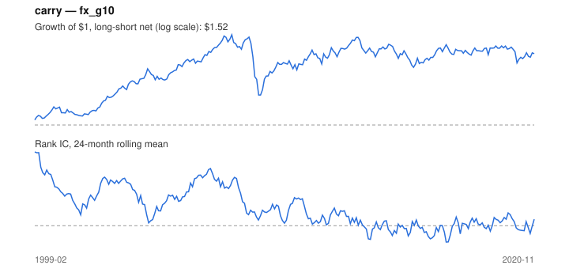

# Signal card: `carry`

Short-rate differential vs the US dollar. Universe: `fx_g10`, 1999-02 to 2020-11 (262 months), net of 10 bp per unit of turnover.

Verdict: **Not promoted** — passes 4 of 6 gates; fails dsr, pbo.

## Why it should work

No rationale recorded.

Reference: Lustig, Roussanov & Verdelhan (2011); Koijen, Moskowitz, Pedersen & Vrugt (2018)

## Data and timing

- Uses returns through the end of month t; the forecast is month t+1's return.
- Source: Ken French data library (industry portfolios, factors), latest vintage.
- Parameters: `{'smooth': 1}`

## Results

| Metric | Value |
|---|---|
| Mean rank IC | 0.088 |
| IC t-stat (Newey-West) | 3.04 |
| IC information ratio (annual) | 0.66 |
| IC hit rate | 59% |
| Long-short return, annual, net | 2.2% |
| Long-short volatility, annual | 7.2% |
| Sharpe, gross / net | 0.32 / 0.30 |
| Sharpe since 2000, net | 0.24 |
| Probabilistic Sharpe (vs 0) | 0.91 |
| Deflated Sharpe (13 trials) | 0.25 |
| Turnover per month | 0.10 |
| Break-even cost | 192 bp |
| Quintile monotonicity | 1.00 |

IC decay (signal at t vs return k months later): 1m +0.088, 2m +0.086, 3m +0.082, 6m +0.084, 12m +0.071

Annual return by quantile: Q1 -0.1%, Q2 +1.8%, Q3 +2.2%

## Promotion gates (PRD §8.4)

| Gate | Threshold | Value | Result |
|---|---|---|---|
| IC t-stat | ≥ 2 | 3.04 | pass |
| Deflated Sharpe | ≥ 0.95 | 0.25 | fail |
| Family PBO | < 20% | 73% | fail |
| Regimes with IC > 0 | ≥ 3 of 4 | 4 of 4 | pass |
| Ensemble ICIR contribution | > 0 | +0.507 | pass |
| Economic rationale | reference | yes | pass |

IC by market regime: down_calm +0.354, down_volatile +0.169, up_calm +0.046, up_volatile +0.069

## Every configuration tried (`carry` family)

PBO across 3 configurations: 73% over 251 common months.

| Configuration | IC | t-stat | Sharpe net | DSR |
|---|---|---|---|---|
| `carry_avg_3` | 0.084 | 3.00 | 0.32 | 0.27 |
| `carry` | 0.088 | 3.04 | 0.30 | 0.25 |
| `carry_avg_12` | 0.073 | 2.65 | 0.21 | 0.14 |

## Tearsheet



## Where it breaks

- Worst drawdown: -30%, from Sep 2007 to Nov 2008.
- Worst 12 months: -26%, ending Nov 2008.
- Since 2000 the net Sharpe is 0.24 versus 0.30 over the full sample.

## Reproduce

```bash
uv run atlas ingest sdmx --agency ecb --agency oecd
uv run atlas research gates --universe fx_g10 --exclude-holdout
uv run atlas research signal carry --universe fx_g10
```

_Generated by `atlas research cards` on 2026-10-21. Do not edit by hand._
