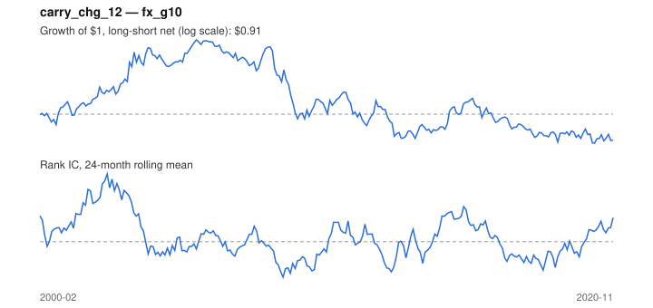

# Signal card: `carry_chg_12`

Change in the rate differential vs the US over 12 months. Universe: `fx_g10`, 2000-02 to 2020-11 (250 months), net of 10 bp per unit of turnover.

Verdict: **Not promoted** — passes 3 of 6 gates; fails ic_tstat, dsr, pbo.

## Why it should work

No rationale recorded.

Reference: Bakshi & Panayotov (2013); rising relative rates attract capital

## Data and timing

- Uses returns through the end of month t; the forecast is month t+1's return.
- Source: Ken French data library (industry portfolios, factors), latest vintage.
- Parameters: `{'months': 12}`

## Results

| Metric | Value |
|---|---|
| Mean rank IC | 0.016 |
| IC t-stat (Newey-West) | 0.63 |
| IC information ratio (annual) | 0.13 |
| IC hit rate | 53% |
| Long-short return, annual, net | -0.3% |
| Long-short volatility, annual | 6.4% |
| Sharpe, gross / net | 0.07 / -0.04 |
| Sharpe since 2000, net | -0.04 |
| Probabilistic Sharpe (vs 0) | 0.43 |
| Deflated Sharpe (13 trials) | 0.01 |
| Turnover per month | 0.58 |
| Break-even cost | 6 bp |
| Quintile monotonicity | 0.50 |

IC decay (signal at t vs return k months later): 1m +0.016, 2m +0.007, 3m -0.002, 6m +0.003, 12m +0.018

Annual return by quantile: Q1 +1.4%, Q2 +1.3%, Q3 +1.8%

## Promotion gates (PRD §8.4)

| Gate | Threshold | Value | Result |
|---|---|---|---|
| IC t-stat | ≥ 2 | 0.63 | fail |
| Deflated Sharpe | ≥ 0.95 | 0.01 | fail |
| Family PBO | < 20% | 71% | fail |
| Regimes with IC > 0 | ≥ 3 of 4 | 3 of 4 | pass |
| Ensemble ICIR contribution | > 0 | +0.125 | pass |
| Economic rationale | reference | yes | pass |

IC by market regime: down_calm +0.112, down_volatile +0.048, up_calm -0.024, up_volatile +0.051

## Every configuration tried (`carry_change` family)

PBO across 2 configurations: 71% over 250 common months.

| Configuration | IC | t-stat | Sharpe net | DSR |
|---|---|---|---|---|
| `carry_chg_6` | 0.011 | 0.42 | -0.01 | 0.02 |
| `carry_chg_12` | 0.016 | 0.63 | -0.04 | 0.01 |

## Tearsheet



## Where it breaks

- Worst drawdown: -32%, from Oct 2005 to Mar 2020.
- Worst 12 months: -23%, ending Jun 2009.
- Since 2000 the net Sharpe is -0.04 versus -0.04 over the full sample.

## Reproduce

```bash
uv run atlas ingest sdmx --agency ecb --agency oecd
uv run atlas research gates --universe fx_g10 --exclude-holdout
uv run atlas research signal carry_chg_12 --universe fx_g10
```

_Generated by `atlas research cards` on 2026-10-21. Do not edit by hand._
